# When Does the Central Limit Theorem Kick In?
Dhruv Shah
2026-10-12

- [<span class="toc-section-number">1</span> Executive
  summary](#executive-summary)
- [<span class="toc-section-number">2</span> Study
  design](#study-design)
  - [<span class="toc-section-number">2.1</span> The question and a
    prediction](#the-question-and-a-prediction)
  - [<span class="toc-section-number">2.2</span> n versus number of
    simulations](#n-versus-number-of-simulations)
  - [<span class="toc-section-number">2.3</span> What “approximately
    normal” means here](#sec-criterion)
  - [<span class="toc-section-number">2.4</span>
    Reproducibility](#reproducibility)
- [<span class="toc-section-number">3</span> Required
  populations](#required-populations)
  - [<span class="toc-section-number">3.1</span> Standard normal: the
    control case](#standard-normal-the-control-case)
  - [<span class="toc-section-number">3.2</span> Six-sided die:
    symmetric and discrete](#six-sided-die-symmetric-and-discrete)
  - [<span class="toc-section-number">3.3</span> Exponential(1): strong
    right skew](#exponential1-strong-right-skew)
  - [<span class="toc-section-number">3.4</span> Binomial(5, 0.10):
    skewed and highly
    discrete](#binomial5-010-skewed-and-highly-discrete)
  - [<span class="toc-section-number">3.5</span> Cauchy(0, 1): when the
    CLT does not apply](#cauchy0-1-when-the-clt-does-not-apply)
- [<span class="toc-section-number">4</span> Extra credit: breaking the
  other assumptions](#extra-credit-breaking-the-other-assumptions)
  - [<span class="toc-section-number">4.1</span> Dependent machine
    failure](#sec-dependent)
  - [<span class="toc-section-number">4.2</span> Non-identical
    Bernoulli: basketball
    fatigue](#non-identical-bernoulli-basketball-fatigue)
  - [<span class="toc-section-number">4.3</span> Age at death: a
    bimodal, real-world-shaped
    population](#age-at-death-a-bimodal-real-world-shaped-population)
- [<span class="toc-section-number">5</span> Cross-population
  comparison](#cross-population-comparison)
  - [<span class="toc-section-number">5.1</span> Prediction vs
    simulation](#prediction-vs-simulation)
  - [<span class="toc-section-number">5.2</span> Is Shapiro–Wilk useful
    here?](#sec-shapiro)
  - [<span class="toc-section-number">5.3</span> Does the seed
    matter?](#sec-robust)
- [<span class="toc-section-number">6</span> Conclusions](#conclusions)
- [Appendix: code](#appendix-code)
  - [Session information](#session-information)

# Executive summary

The question this project asks is simple: **is n = 30 enough for the
sampling distribution of the mean to be approximately normal?** I
simulated 10,000 sample means at each of 11 sample sizes (n = 2, 5, 10,
20, 30, 50, 100, 250, 500, 1000, 2000) for the five required populations
and all three extra-credit processes, then judged normality with four
checks applied identically everywhere (defined in
<a href="#sec-criterion" class="quarto-xref">Section 2.3</a>).

**Short answer: no. 30 is a rule of thumb that is right for well-behaved
populations and wrong for the rest.**

| Population | CLT assumptions | Predicted n | Observed n | Skew @ n=30 | SD/SE @ n=30 | Tail rate @ n=30 | Normal @ n=30? |
|:---|:---|:---|:---|:---|:---|:---|:---|
| Standard Normal | None (i.i.d., finite variance) | 1 | 2 | -0.01 | 1.01 | 5.2% | Yes |
| Six-Sided Die | None (i.i.d., finite variance) | 5 | 10 | 0.00 | 1.00 | 4.8% | Yes |
| Exponential (rate = 1) | None (i.i.d., finite variance) | 100 | 100 | 0.40 | 0.99 | 4.8% | No |
| Binomial (5, 0.10) | None (i.i.d., finite variance) | 36 | 50 | 0.21 | 1.00 | 4.4% | No |
| Cauchy (0, 1) | Breaks: finite variance | n/a | \> 2000 | undefined | undefined | undefined | No |
| Dependent Machine Failure | Breaks: independent | n/a | 1000 | 0.75 | 1.01 | 4.4% | No |
| Non-identical Bernoulli (Fatigue) | Breaks: identical | 15 | 100 | -0.14 | 0.99 | 5.9% | Yes |
| Age at Death (Mixture) | None (i.i.d., finite variance) | 19 | 50 | -0.20 | 1.01 | 5.1% | No |

*Predicted n* comes from theory before simulating: the smallest n at
which the skewness and kurtosis of the sample mean fall inside my
thresholds. *Observed n* is the smallest simulated n from which **all
four** checks pass and keep passing at every larger n.

Key findings:

1.  **Shape of the parent drives the speed.** For i.i.d. data the
    skewness of $\bar X$ is $\gamma_1/\sqrt n$. The exponential
    ($\gamma_1 = 2$) needs about n = 100 before passing every check; a
    symmetric die needs only 10.
2.  **Discreteness causes trouble the moments miss.** Binomial(5, 0.10)
    and the fatigue model are lattice-valued, so even when skewness is
    small, the share of means beyond ±1.96 SE jumps around because the
    possible values are spaced unevenly relative to the cutoff.
3.  **The Cauchy never converges.** The sample mean of 2,000 Cauchy
    draws is just as spread out as a single draw (IQR ≈ 2 at every n). A
    larger sample does not help when the variance is infinite.
4.  **Dependence breaks the standard-error formula, not only the
    shape.** For the machine-failure process the naive $\sigma/\sqrt n$
    overstates the true SE by about 16%. Negative autocorrelation makes
    the true SE *smaller*, while the heavy-tailed long-run distribution
    makes it the slowest finite-variance case to lose its skew (observed
    n = 1000).
5.  **Non-identical (but independent) shots still obey a CLT**
    (Lindeberg–Feller). However, the textbook formula
    $\sqrt{\bar p(1-\bar p)/n}$ overstates the SE by about 5%, because
    varying probabilities reduce variance.

# Study design

## The question and a prediction

The CLT says that if $X_1,\dots,X_n$ are **independent, identically
distributed, with finite variance** $\sigma^2$, then

$$\frac{\bar X - \mu}{\sigma/\sqrt n} \xrightarrow{d} N(0,1).$$

It says nothing about *how large* n must be. For that I used two
classical consequences of independence:

$$\operatorname{skew}(\bar X) = \frac{\gamma_1}{\sqrt n}, \qquad \operatorname{exkurt}(\bar X) = \frac{\gamma_2}{n},$$

where $\gamma_1$ and $\gamma_2$ are the population’s skewness and excess
kurtosis. These give a **prediction** for each population that the
simulation can confirm or refute. Skewness fades slowly ($1/\sqrt n$),
so to halve it you need four times the data.

| Population | Type | Mean | SD | Skewness | Excess kurtosis | Predicted n |
|:---|:---|---:|---:|---:|---:|:---|
| Standard Normal | continuous | 0.000 | 1.000 | 0.000 | 0.000 | 1 |
| Six-Sided Die | discrete | 3.500 | 1.708 | 0.000 | -1.269 | 5 |
| Exponential (rate = 1) | continuous | 1.000 | 1.000 | 2.000 | 6.000 | 100 |
| Binomial (5, 0.10) | discrete | 0.500 | 0.671 | 1.193 | 1.022 | 36 |
| Cauchy (0, 1) | continuous | 0.000 | n/a | n/a | n/a | n/a |
| Dependent Machine Failure | continuous | 1.676 | 2.551 | 2.901 | 12.491 | n/a |
| Non-identical Bernoulli (Fatigue) | discrete | 0.700 | 0.458 | n/a | n/a | 15 |
| Age at Death (Mixture) | discrete | 49.981 | 27.635 | -0.862 | -0.790 | 19 |

Notes on the table: the Cauchy’s “mean” is its location/median, and its
moments do not exist. The dependent process has no closed form, so its
moments come from a 1,000,000-step simulated chain
(<a href="#sec-dependent" class="quarto-xref">Section 4.1</a>). The
fatigue model has no single population because $p$ changes shot to shot;
its prediction uses the exact Poisson-binomial formulas.

## n versus number of simulations

These are separate:

- **n** is the number of observations in *one* sample: 2, 5, 10, 20, 30,
  50, 100, 250, 500, 1000, 2000.
- **Replications** are how many samples I generate per n: 10,000. Each
  gives one sample mean, and together they form the *sampling
  distribution*.

10,000 replications at n = 30 is still a sample size of 30.

## What “approximately normal” means here

No single cutoff is universal, so I fixed one before looking at results
and applied it everywhere. At a given n, the sampling distribution
counts as **approximately normal only if all four checks pass**:

| Check | Rule | Why |
|----|----|----|
| Symmetry | \|skewness\| ≤ 0.2 | The CLT’s first visible failure is a lopsided histogram |
| Tails | \|excess kurtosis\| ≤ 0.3 | Heavy or light tails distort extreme probabilities |
| Spread | 0.97 ≤ simulated SD / theoretical SE ≤ 1.03 | The CLT’s $\sigma/\sqrt n$ must actually describe the spread |
| Usefulness | 4% – 6% of means beyond $\mu \pm 1.96\,SE$ | A 95% normal interval should miss about 5% of the time |

Each threshold is several Monte Carlo standard errors wide, so a pass or
fail reflects the population rather than simulation noise. With 10,000
replications, SE(skewness) ≈ 0.025, SE(kurtosis) ≈ 0.05, SE(tail rate) ≈
0.002, and the SD ratio is accurate to about 0.7%.

I also report histograms, Q–Q plots and the **Shapiro–Wilk** test, but I
do not use Shapiro–Wilk as a criterion. With 5,000 values it detects
deviations far too small to matter (see
<a href="#sec-shapiro" class="quarto-xref">Section 5.2</a>).

For the dependent and fatigue processes, the “theoretical SE” in the
spread and tail checks is the **correct** SE for that process. I report
the naive i.i.d. formula separately, because applying it blindly is
exactly the mistake those cases are meant to expose.

## Reproducibility

- The seed is `SEED = 6877`, the last four digits of my student ID, set
  in `R/config.R`. Each population uses `SEED + k`, so any section can
  be re-run on its own and reproduce exactly.
- All simulation logic lives in reusable functions in `R/` and is shown
  in the appendix.
- Re-rendering `report/clt_project_1.qmd` with Quarto regenerates every
  number, table and figure in this report and in `output/`.

# Required populations

## Standard normal: the control case

**Prediction.** Every linear combination of independent normals is
normal, so $\bar X \sim N(0, 1/n)$ *exactly* at every n. If anything
fails here, the method is broken, not the CLT.

``` r
set.seed(SEED); plot_population(pop_normal)
```

<div id="fig-normal-pop">

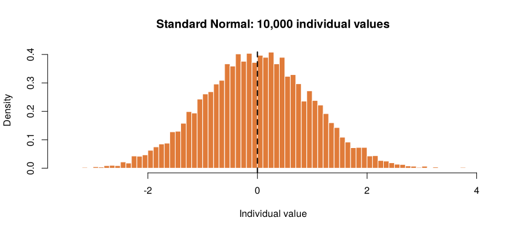

Figure 1: Individual values from N(0, 1).

</div>

``` r
plot_sampling_grid(results$normal)
```

<div id="fig-normal-hist">

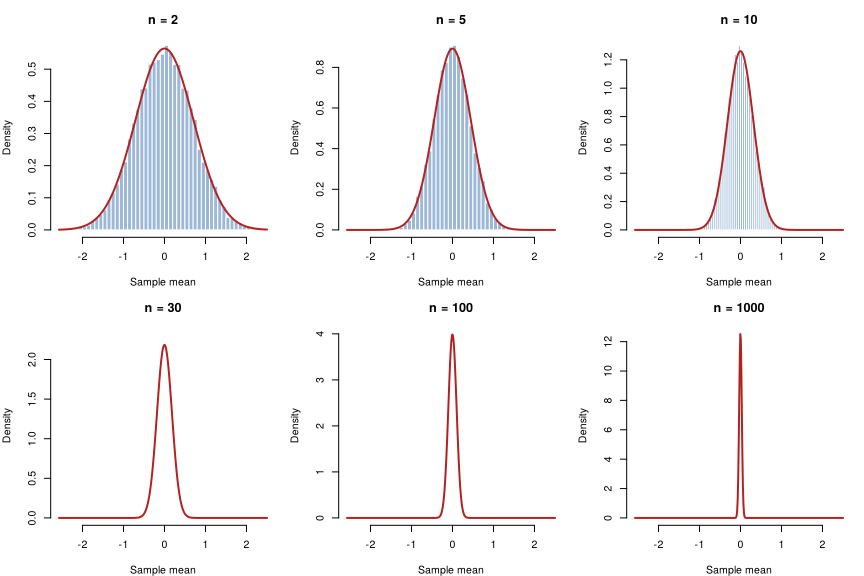

Figure 2: Sampling distributions of the mean with the CLT normal curve
(red). Same x-axis in every panel.

</div>

``` r
plot_qq_grid(results$normal)
```

<div id="fig-normal-qq">

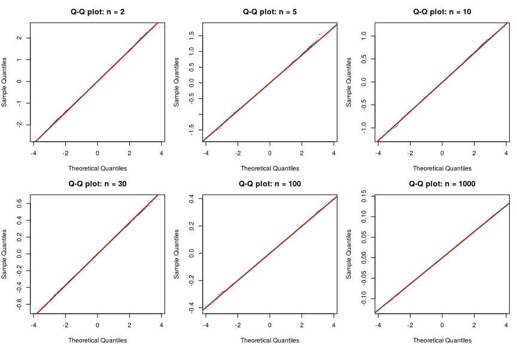

Figure 3: Normal Q-Q plots of the sample means.

</div>

| n | Sim mean | Theory mean | Sim SD | Theory SE | SD/SE | Skew | Pred. skew | Ex. kurt | Pred. kurt | Tail rate | SW p | Normal |
|---:|---:|---:|---:|---:|---:|---:|---:|---:|---:|---:|---:|:---|
| 2 | 0.006 | 0 | 0.708 | 0.707 | 1.002 | 0.032 | 0 | 0.007 | 0 | 0.049 | 0.076 | Yes |
| 5 | 0.001 | 0 | 0.447 | 0.447 | 0.999 | 0.058 | 0 | 0.075 | 0 | 0.048 | 0.008 | Yes |
| 10 | -0.006 | 0 | 0.320 | 0.316 | 1.011 | 0.041 | 0 | 0.045 | 0 | 0.053 | 0.140 | Yes |
| 20 | -0.003 | 0 | 0.225 | 0.224 | 1.004 | 0.022 | 0 | -0.025 | 0 | 0.049 | 0.750 | Yes |
| 30 | 0.000 | 0 | 0.185 | 0.183 | 1.011 | -0.015 | 0 | -0.051 | 0 | 0.052 | 0.880 | Yes |
| 50 | 0.000 | 0 | 0.143 | 0.141 | 1.011 | 0.005 | 0 | -0.025 | 0 | 0.050 | 0.560 | Yes |
| 100 | 0.000 | 0 | 0.099 | 0.100 | 0.992 | 0.030 | 0 | 0.016 | 0 | 0.048 | 0.850 | Yes |
| 250 | 0.000 | 0 | 0.063 | 0.063 | 0.992 | 0.023 | 0 | -0.019 | 0 | 0.047 | 0.710 | Yes |
| 500 | 0.000 | 0 | 0.045 | 0.045 | 0.999 | -0.011 | 0 | -0.010 | 0 | 0.050 | 0.840 | Yes |
| 1000 | 0.000 | 0 | 0.032 | 0.032 | 1.014 | 0.015 | 0 | 0.006 | 0 | 0.052 | 0.910 | Yes |
| 2000 | 0.000 | 0 | 0.022 | 0.022 | 0.995 | 0.059 | 0 | 0.060 | 0 | 0.050 | 0.270 | Yes |

**Result.** Every check passes from n = 2 onward. Skewness and kurtosis
stay within Monte Carlo noise of 0, the SD/SE ratio is within about 1.5%
of 1, and about 5% of means land beyond ±1.96 SE. Shapiro–Wilk rejects
at the 5% level in 1 of 11 tests, which is what chance alone produces
when the null is true. This validates the simulation and the criteria:
they do not invent non-normality where there is none.

## Six-sided die: symmetric and discrete

**Prediction.** $\mu = 3.5$, $\sigma = \sqrt{35/12} \approx 1.708$. The
die is perfectly symmetric (skewness 0) but flat, with excess kurtosis
−1.27. Theory says $|\text{exkurt}(\bar X)| = 1.27/n$ drops below 0.3 by
about n = 5, so this should be fast.

``` r
set.seed(SEED); plot_population(pop_die)
```

<div id="fig-die-pop">

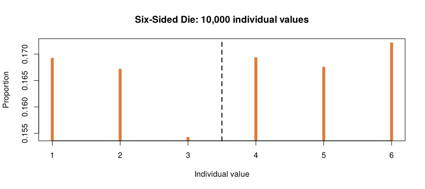

Figure 4: A fair die: six equally likely values.

</div>

``` r
plot_sampling_grid(results$die)
```

<div id="fig-die-hist">

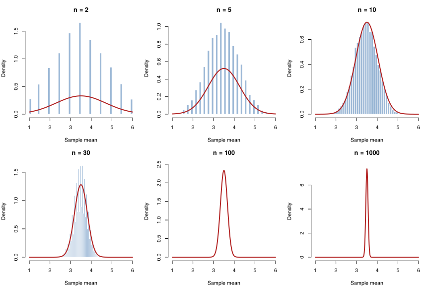

Figure 5: Sampling distributions of the mean for a fair die.

</div>

``` r
plot_qq_grid(results$die)
```

<div id="fig-die-qq">

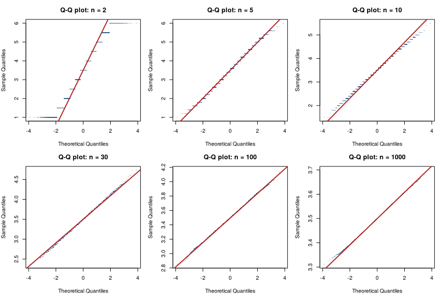

Figure 6: Q-Q plots: the staircase at small n is the discreteness of the
die.

</div>

| n | Sim mean | Theory mean | Sim SD | Theory SE | SD/SE | Skew | Pred. skew | Ex. kurt | Pred. kurt | Tail rate | SW p | Normal |
|---:|---:|---:|---:|---:|---:|---:|---:|---:|---:|---:|---:|:---|
| 2 | 3.494 | 3.5 | 1.204 | 1.208 | 0.997 | 0.010 | 0 | -0.630 | -0.634 | 0.055 | 0.000 | No |
| 5 | 3.488 | 3.5 | 0.768 | 0.764 | 1.005 | 0.003 | 0 | -0.248 | -0.254 | 0.069 | 0.000 | No |
| 10 | 3.506 | 3.5 | 0.537 | 0.540 | 0.995 | -0.037 | 0 | -0.103 | -0.127 | 0.050 | 0.000 | Yes |
| 20 | 3.497 | 3.5 | 0.384 | 0.382 | 1.006 | 0.000 | 0 | -0.038 | -0.063 | 0.059 | 0.000 | Yes |
| 30 | 3.496 | 3.5 | 0.312 | 0.312 | 0.999 | 0.004 | 0 | -0.027 | -0.042 | 0.048 | 0.000 | Yes |
| 50 | 3.498 | 3.5 | 0.239 | 0.242 | 0.990 | 0.047 | 0 | -0.027 | -0.025 | 0.048 | 0.002 | Yes |
| 100 | 3.498 | 3.5 | 0.170 | 0.171 | 0.996 | 0.010 | 0 | -0.006 | -0.013 | 0.052 | 0.160 | Yes |
| 250 | 3.500 | 3.5 | 0.106 | 0.108 | 0.983 | 0.007 | 0 | 0.050 | -0.005 | 0.049 | 0.051 | Yes |
| 500 | 3.500 | 3.5 | 0.076 | 0.076 | 0.998 | 0.003 | 0 | 0.085 | -0.003 | 0.052 | 0.290 | Yes |
| 1000 | 3.500 | 3.5 | 0.054 | 0.054 | 0.996 | 0.027 | 0 | -0.118 | -0.001 | 0.049 | 0.099 | Yes |
| 2000 | 3.499 | 3.5 | 0.038 | 0.038 | 1.003 | 0.015 | 0 | -0.021 | -0.001 | 0.051 | 0.970 | Yes |

**Result.** The mean of two dice is already triangular and the mean of
five already looks bell-shaped. The die passes every check from n = 10.
Before that, the problem is the **flat shape** (negative kurtosis) and,
at n = 5, **discreteness**: the mean can only take values in steps of
1/n, so the share of means beyond ±1.96 SE (6.9% at n = 5) depends on
where those steps fall. The Q–Q staircase at small n shows the same
thing. Symmetric populations converge quickly, as predicted.

## Exponential(1): strong right skew

**Prediction.** $\mu = \sigma = 1$, skewness 2, excess kurtosis 6. The
skewness of $\bar X$ is $2/\sqrt n$, which is still 0.37 at n = 30 and
reaches 0.20 only at **n = 100**. This is the population where “n = 30”
should visibly fall short.

``` r
set.seed(SEED); plot_population(pop_exp)
```

<div id="fig-exp-pop">

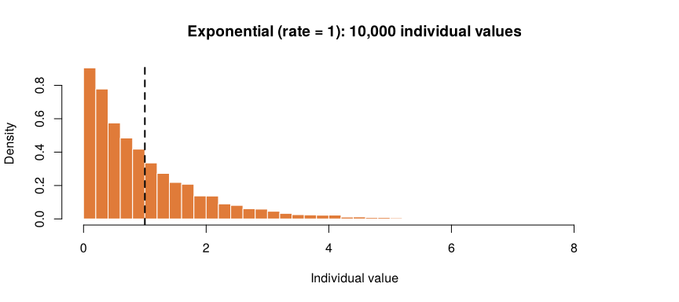

Figure 7: Exponential(1): most values are small, with a long right tail.

</div>

``` r
plot_sampling_grid(results$exponential, common_x = FALSE)
```

<div id="fig-exp-hist">

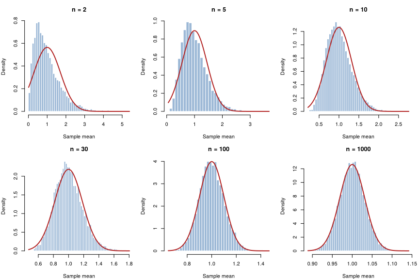

Figure 8: Sampling distributions for the exponential. Note the
persistent right tail at n = 30.

</div>

``` r
plot_qq_grid(results$exponential)
```

<div id="fig-exp-qq">

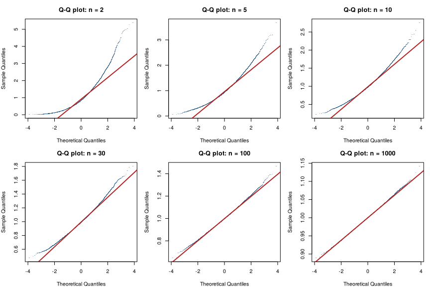

Figure 9: Q-Q plots for the exponential: upward curvature means right
skew.

</div>

``` r
plot_shape_trend(results$exponential)
```

<div id="fig-exp-trend">

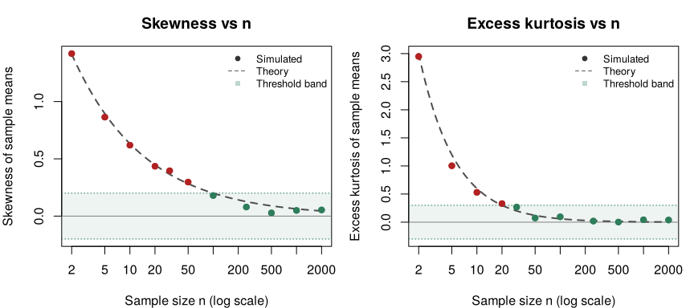

Figure 10: Skewness and kurtosis of the sample means against n (log
scale). Dashed line: theory. Shaded band: my threshold.

</div>

| n | Sim mean | Theory mean | Sim SD | Theory SE | SD/SE | Skew | Pred. skew | Ex. kurt | Pred. kurt | Tail rate | SW p | Normal |
|---:|---:|---:|---:|---:|---:|---:|---:|---:|---:|---:|---:|:---|
| 2 | 0.998 | 1 | 0.701 | 0.707 | 0.991 | 1.419 | 1.414 | 2.949 | 3.000 | 0.047 | 0.000 | No |
| 5 | 0.996 | 1 | 0.446 | 0.447 | 0.997 | 0.864 | 0.894 | 1.003 | 1.200 | 0.043 | 0.000 | No |
| 10 | 1.005 | 1 | 0.317 | 0.316 | 1.004 | 0.619 | 0.632 | 0.530 | 0.600 | 0.046 | 0.000 | No |
| 20 | 1.000 | 1 | 0.222 | 0.224 | 0.992 | 0.435 | 0.447 | 0.330 | 0.300 | 0.044 | 0.000 | No |
| 30 | 1.001 | 1 | 0.182 | 0.183 | 0.995 | 0.396 | 0.365 | 0.268 | 0.200 | 0.048 | 0.000 | No |
| 50 | 1.001 | 1 | 0.141 | 0.141 | 1.000 | 0.297 | 0.283 | 0.074 | 0.120 | 0.047 | 0.000 | No |
| 100 | 1.000 | 1 | 0.100 | 0.100 | 1.001 | 0.180 | 0.200 | 0.095 | 0.060 | 0.051 | 0.000 | Yes |
| 250 | 1.001 | 1 | 0.064 | 0.063 | 1.007 | 0.079 | 0.126 | 0.019 | 0.024 | 0.051 | 0.004 | Yes |
| 500 | 1.000 | 1 | 0.045 | 0.045 | 0.996 | 0.028 | 0.089 | 0.002 | 0.012 | 0.050 | 0.970 | Yes |
| 1000 | 1.000 | 1 | 0.031 | 0.032 | 0.993 | 0.050 | 0.063 | 0.042 | 0.006 | 0.049 | 0.610 | Yes |
| 2000 | 1.000 | 1 | 0.022 | 0.022 | 1.001 | 0.054 | 0.045 | 0.038 | 0.003 | 0.048 | 0.370 | Yes |

**Result.** The simulated skewness follows $2/\sqrt n$ closely (dashed
curve), which confirms the prediction quantitatively. At n = 30 the
skewness is 0.40, so the histogram still has a visible right tail and
the Q–Q plot still curves upward. The center and spread are already
right, though: the simulated mean is 1.001 and the SD/SE ratio is 0.99.
The CLT gets the **location and scale** right long before it gets the
**shape** right. All four checks pass from n = 100. Because the
predicted threshold n = 100 sits right at the boundary, Monte Carlo
noise decides whether n = 100 itself passes (see
<a href="#sec-robust" class="quarto-xref">Section 5.3</a>).

## Binomial(5, 0.10): skewed and highly discrete

**Prediction.** $\mu = 0.5$, $\sigma = \sqrt{0.45} \approx 0.671$,
skewness ≈ 1.19, excess kurtosis ≈ 1.02. About 59% of draws are exactly
0. Theory predicts skewness below 0.20 at about n = 36. The sum of n
draws is Binomial(5n, 0.1), so the sample mean lives on a lattice of
step $1/n$.

``` r
set.seed(SEED); plot_population(pop_binom)
```

<div id="fig-binom-pop">

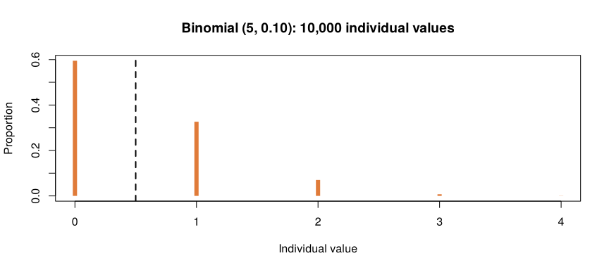

Figure 11: Binomial(5, 0.10): mostly zeros, rarely more than 2.

</div>

``` r
plot_sampling_grid(results$binomial, common_x = FALSE)
```

<div id="fig-binom-hist">

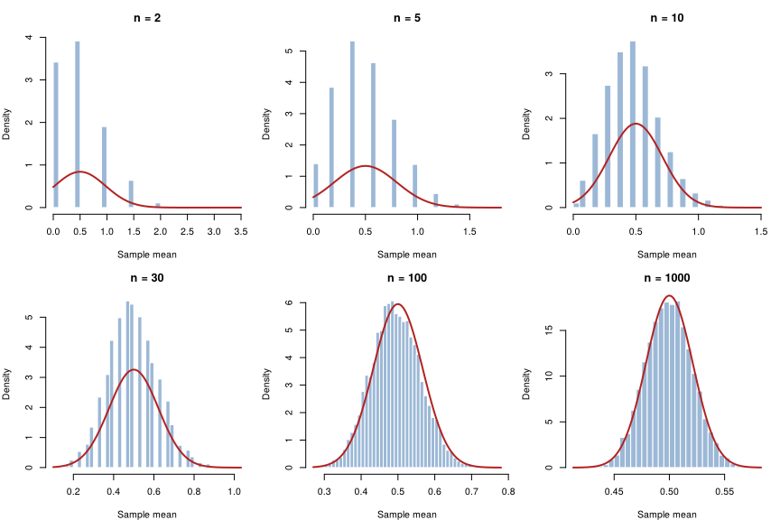

Figure 12: Sampling distributions for Binomial(5, 0.10). Gaps between
bars are the lattice of possible means.

</div>

``` r
plot_qq_grid(results$binomial)
```

<div id="fig-binom-qq">

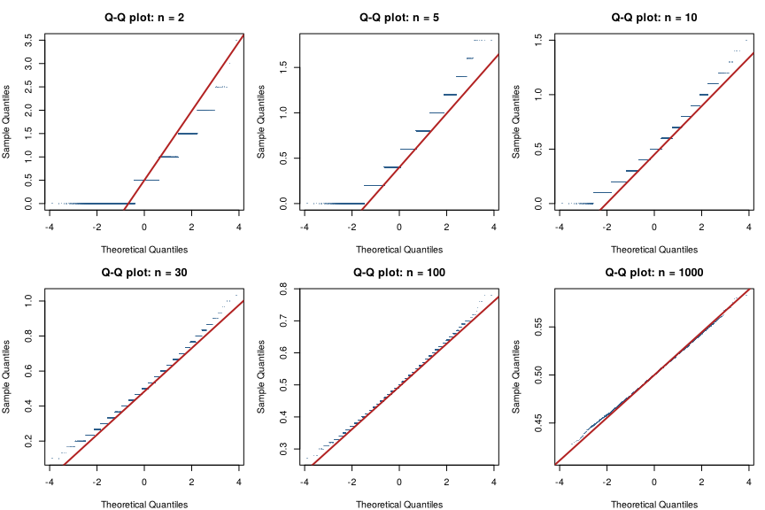

Figure 13: Q-Q plots: a skewed staircase that smooths out as n grows.

</div>

``` r
plot_shape_trend(results$binomial)
```

<div id="fig-binom-trend">

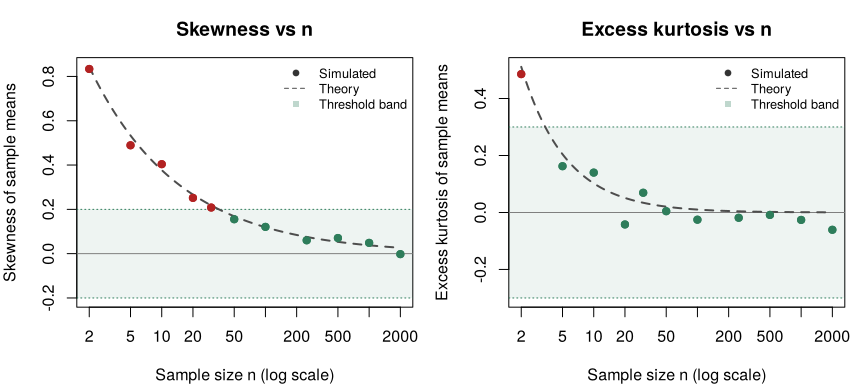

Figure 14: Skewness and kurtosis vs n for Binomial(5, 0.10).

</div>

| n | Sim mean | Theory mean | Sim SD | Theory SE | SD/SE | Skew | Pred. skew | Ex. kurt | Pred. kurt | Tail rate | SW p | Normal |
|---:|---:|---:|---:|---:|---:|---:|---:|---:|---:|---:|---:|:---|
| 2 | 0.508 | 0.5 | 0.478 | 0.474 | 1.007 | 0.834 | 0.843 | 0.486 | 0.511 | 0.076 | 0.000 | No |
| 5 | 0.504 | 0.5 | 0.297 | 0.300 | 0.991 | 0.489 | 0.533 | 0.162 | 0.204 | 0.030 | 0.000 | No |
| 10 | 0.499 | 0.5 | 0.215 | 0.212 | 1.014 | 0.404 | 0.377 | 0.140 | 0.102 | 0.033 | 0.000 | No |
| 20 | 0.499 | 0.5 | 0.150 | 0.150 | 0.998 | 0.252 | 0.267 | -0.042 | 0.051 | 0.064 | 0.000 | No |
| 30 | 0.500 | 0.5 | 0.123 | 0.122 | 1.003 | 0.208 | 0.218 | 0.069 | 0.034 | 0.044 | 0.000 | No |
| 50 | 0.501 | 0.5 | 0.095 | 0.095 | 0.997 | 0.155 | 0.169 | 0.004 | 0.020 | 0.044 | 0.000 | Yes |
| 100 | 0.499 | 0.5 | 0.067 | 0.067 | 1.003 | 0.121 | 0.119 | -0.025 | 0.010 | 0.043 | 0.000 | Yes |
| 250 | 0.500 | 0.5 | 0.042 | 0.042 | 0.994 | 0.060 | 0.075 | -0.019 | 0.004 | 0.053 | 0.001 | Yes |
| 500 | 0.500 | 0.5 | 0.030 | 0.030 | 1.009 | 0.071 | 0.053 | -0.009 | 0.002 | 0.049 | 0.025 | Yes |
| 1000 | 0.500 | 0.5 | 0.021 | 0.021 | 1.003 | 0.049 | 0.038 | -0.026 | 0.001 | 0.050 | 0.290 | Yes |
| 2000 | 0.500 | 0.5 | 0.015 | 0.015 | 0.995 | -0.002 | 0.027 | -0.061 | 0.001 | 0.049 | 0.410 | Yes |

**Result.** Skewness again tracks theory, reaching 0.21 at n = 30, right
at the threshold. The more interesting failure is the **tail rate**:
7.6% at n = 2, 3.3% at n = 10, and 6.4% at n = 20. It swings above and
below 5% because only a few lattice points lie near ±1.96 SE, so a
normal-based 95% interval can be noticeably too wide or too narrow.
Moments alone would not reveal this; it is why I included a check that
uses the approximation directly. All checks pass from n = 50.

## Cauchy(0, 1): when the CLT does not apply

**Prediction.** The Cauchy has no mean and no variance, so the CLT’s
finite-variance condition fails. Theory gives a stronger statement: the
mean of n i.i.d. Cauchy(0, 1) draws is itself **exactly Cauchy(0, 1)**.
Averaging should not help at all. The IQR of the sample means should
stay at 2 (the Cauchy IQR) for every n, rather than shrinking like
$1/\sqrt n$.

``` r
set.seed(SEED); plot_population(pop_cauchy, xlim = c(-10, 10))
```

<div id="fig-cauchy-pop">

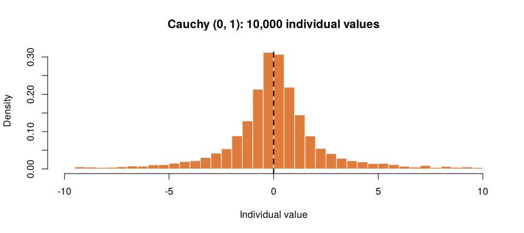

Figure 15: Cauchy(0, 1), shown on \[-10, 10\]. About 6% of values fall
outside this window.

</div>

``` r
plot_sampling_grid(results$cauchy, xlim = c(-10, 10))
```

<div id="fig-cauchy-hist">

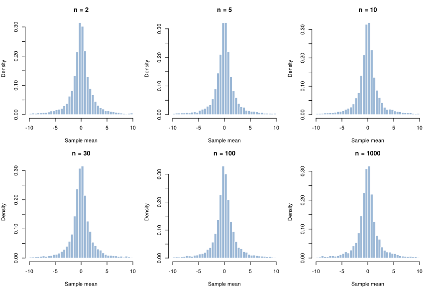

Figure 16: Sampling distributions of the Cauchy mean on a fixed window
\[-10, 10\]. They do not narrow as n grows. Theory does not supply a
normal curve here.

</div>

``` r
plot_qq_grid(results$cauchy)
```

<div id="fig-cauchy-qq">

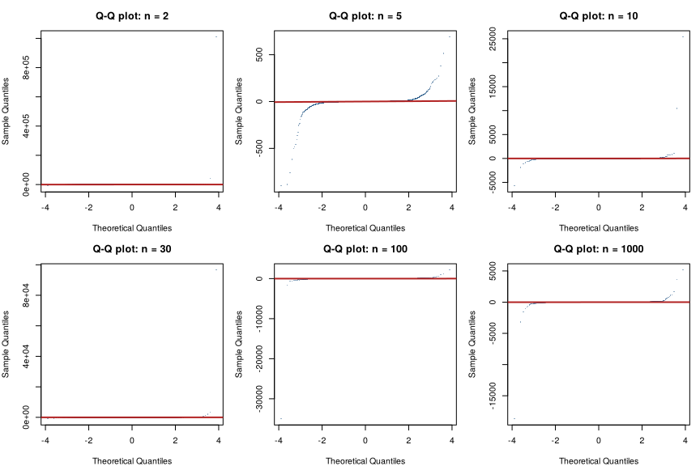

Figure 17: Q-Q plots: extreme points at both ends at every n.

</div>

Moment-based diagnostics are meaningless here because the quantities
they estimate do not exist. Instead I use quantile-based summaries,
which do exist:

``` r
cauchy_tbl <- data.frame(
  n = results$cauchy$diag$n,
  `Sim mean (unstable)` = results$cauchy$diag$sim_mean,
  `IQR of means` = results$cauchy$diag$iqr,
  `IQR theory (Cauchy)` = 2,
  `IQR if it shrank like 1/sqrt(n)` = 2 / sqrt(results$cauchy$diag$n),
  `Share |mean| > 10` = sapply(results$cauchy$means, function(m) mean(abs(m) > 10)),
  `Theory share` = 2 * pcauchy(-10),
  check.names = FALSE
)
kbl(cauchy_tbl)
```

| n | Sim mean (unstable) | IQR of means | IQR theory (Cauchy) | IQR if it shrank like 1/sqrt(n) | Share \|mean\| \> 10 | Theory share |
|---:|---:|---:|---:|---:|---:|---:|
| 2 | 103.903 | 2.065 | 2 | 1.414 | 0.065 | 0.063 |
| 5 | -0.345 | 1.978 | 2 | 0.894 | 0.060 | 0.063 |
| 10 | 2.821 | 1.947 | 2 | 0.632 | 0.062 | 0.063 |
| 20 | 0.198 | 1.953 | 2 | 0.447 | 0.067 | 0.063 |
| 30 | 10.118 | 1.972 | 2 | 0.365 | 0.061 | 0.063 |
| 50 | 0.490 | 1.952 | 2 | 0.283 | 0.059 | 0.063 |
| 100 | -3.430 | 2.015 | 2 | 0.200 | 0.063 | 0.063 |
| 250 | 1.199 | 1.997 | 2 | 0.126 | 0.068 | 0.063 |
| 500 | 0.395 | 1.996 | 2 | 0.089 | 0.059 | 0.063 |
| 1000 | -0.864 | 1.995 | 2 | 0.063 | 0.066 | 0.063 |
| 2000 | 2.966 | 1.990 | 2 | 0.045 | 0.066 | 0.063 |

The IQR column is the evidence: about 2 at n = 2 and still about 2 at n
= 2,000. The share of extreme means stays near the theoretical 6.3%. The
average of the 10,000 sample means jumps around (-3.43 to 103.90),
because one enormous draw can dominate any average.

``` r
set.seed(SEED + 50)
xc <- rcauchy(5000)
run_mean <- cumsum(xc) / seq_along(xc)
run_med  <- vapply(seq(10, 5000, by = 10), function(i) median(xc[1:i]), 0)
plot(run_mean, type = "l", col = PAL$fail, xlab = "Number of observations",
     ylab = "Running estimate", main = "Cauchy: running mean vs running median")
lines(seq(10, 5000, by = 10), run_med, col = "#1B6CA8", lwd = 2)
abline(h = 0, lty = 2)
legend("topright", c("Mean", "Median"), col = c(PAL$fail, "#1B6CA8"),
       lwd = c(1, 2), bty = "n")
```

<div id="fig-cauchy-running">

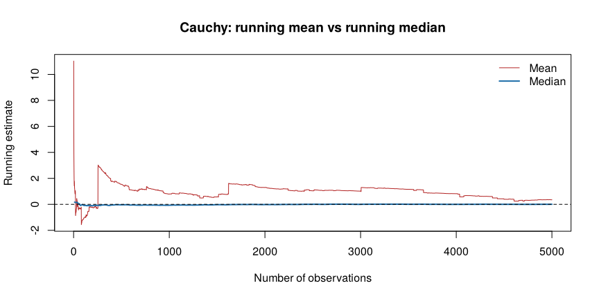

Figure 18: A single Cauchy sequence: the running mean never settles,
while the running median converges to 0.

</div>

**Result.** The CLT does not apply, and no sample size rescues it. The
fix is a different statistic: the sample **median** of Cauchy data *is*
asymptotically normal (with SE $\pi/(2\sqrt n)$), which is why robust
estimators matter for heavy-tailed data such as financial returns.

# Extra credit: breaking the other assumptions

The three extra populations each break a *different* CLT assumption, or
stress the CLT in a different way:

| Process | Independent? | Identically distributed? | Finite variance? |
|----|----|----|----|
| Dependent machine failure | **No** | Yes (stationary) | Yes |
| Non-identical Bernoulli (fatigue) | Yes | **No** | Yes |
| Age at death (mixture) | Yes | Yes | Yes, but bimodal and irregular |

## Dependent machine failure

**Model** (from the course handout):
$\lambda_t = \lambda_0 e^{\beta(X_{t-1}-\mu)}$ and
$X_t \mid X_{t-1} \sim \text{Exp}(\lambda_t)$, with $\lambda_0 = 1$,
$\beta = 1.25$, $\mu = 1$. A long operating period raises the next
failure rate, so long periods tend to be followed by short ones.

**Design decision.** Each simulated sample discards a 50-step burn-in,
so samples come from the process’s long-run behaviour rather than its
start-up. One sample of size n is n *consecutive* operating times from
one machine, and the 10,000 replications are independent machines.

**Prediction.** Three things should differ from the i.i.d. exponential:

1.  The long-run distribution is *not* Exp(1). The handout warns that
    conditional exponential does not mean marginal exponential.
2.  Negative lag-1 correlation should make the true SE **smaller** than
    $\sigma/\sqrt n$, because errors partly cancel.
3.  The correct variance is
    $\operatorname{Var}(\bar X) = \frac{\sigma^2}{n}\left[1 + 2\sum_{k=1}^{n-1}\left(1-\frac kn\right)\rho_k\right]$.

``` r
old <- par(mfrow = c(2, 2), mar = c(4, 4, 3, 1))
plot(dep_moments$chain_head, type = "h", col = PAL$pop,
     xlab = "Failure number t", ylab = "Operating time", main = "200 consecutive operating times")
set.seed(SEED + 60); ch <- dependent_chain(20000)
plot(head(ch, -1), tail(ch, -1), pch = 16, cex = 0.3, col = adjustcolor("#2B5C8A", 0.3),
     xlab = expression(X[t-1]), ylab = expression(X[t]), main = "Lag-1 relationship",
     xlim = c(0, 12), ylim = c(0, 12))
barplot(dep_moments$rho[1:15], names.arg = 1:15, col = ifelse(dep_moments$rho[1:15] < 0, PAL$fail, PAL$pass),
        border = NA, xlab = "Lag k", ylab = expression(rho[k]), main = "Autocorrelation")
abline(h = 0)
hist(ch[ch < 15], breaks = 80, probability = TRUE, col = PAL$pop, border = "white",
     xlab = "Operating time", main = "Long-run distribution vs Exp(1)")
curve(dexp(x, 1), add = TRUE, lwd = 2, col = "gray20", lty = 2)
legend("topright", c("Simulated", "Exp(1)"), fill = c(PAL$pop, NA), border = c("white", NA),
       lty = c(NA, 2), col = c(NA, "gray20"), bty = "n")
par(old)
```

<div id="fig-dep-process">

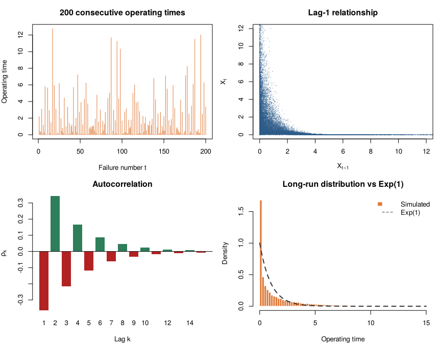

Figure 19: The dependent process. Top left: 200 consecutive operating
times (long is followed by short). Top right: lag-1 scatter. Bottom
left: autocorrelations alternate in sign and die out. Bottom right: the
long-run distribution is not Exp(1).

</div>

| Quantity                        | Dependent process | Independent Exp(1) |
|:--------------------------------|------------------:|-------------------:|
| Long-run mean                   |             1.676 |                  1 |
| Long-run SD                     |             2.551 |                  1 |
| Skewness                        |             2.901 |                  2 |
| Excess kurtosis                 |            12.491 |                  6 |
| Lag-1 autocorrelation           |            -0.365 |                  0 |
| Variance factor 1 + 2\*sum(rho) |             0.731 |                  1 |

``` r
plot_sampling_grid(results$dependent, common_x = FALSE)
```

<div id="fig-dep-hist">

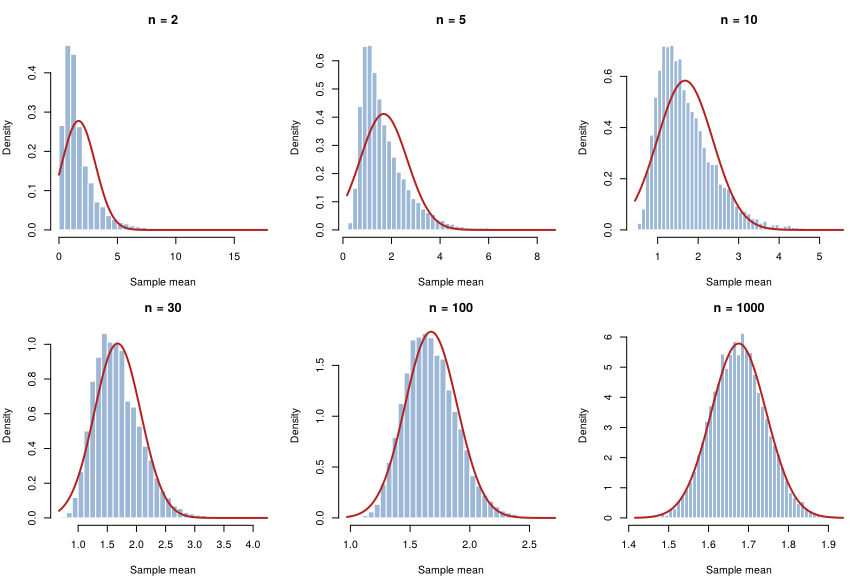

Figure 20: Sampling distributions for the dependent process with the
correct (autocorrelation-adjusted) normal curve.

</div>

``` r
plot_qq_grid(results$dependent)
```

<div id="fig-dep-qq">

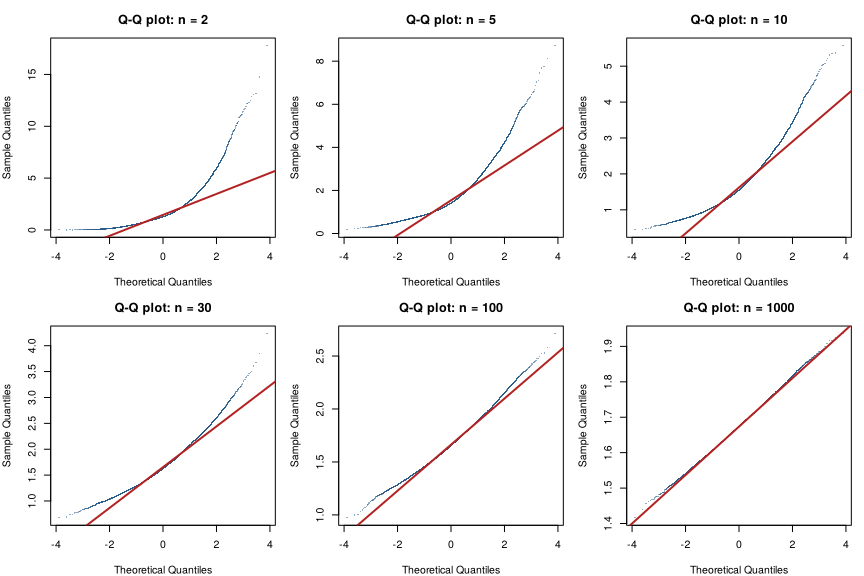

Figure 21: Q-Q plots for the dependent process.

</div>

``` r
plot_se_check(results$dependent, show_naive = TRUE)
```

<div id="fig-dep-se">

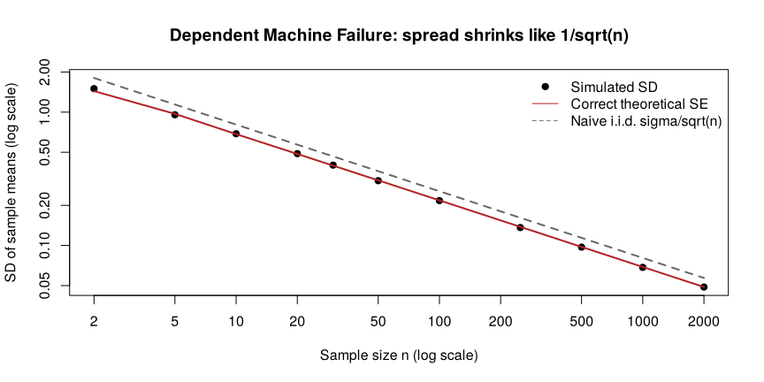

Figure 22: The naive i.i.d. formula overstates the spread at every n;
the autocorrelation-adjusted SE matches the simulation.

</div>

| n | Sim mean | Sim SD | Naive SE | SD / naive SE | Correct SE | SD / correct SE | Skew | Ex. kurt | Tail rate | Normal |
|---:|---:|---:|---:|---:|---:|---:|---:|---:|---:|:---|
| 2 | 1.701 | 1.500 | 1.804 | 0.832 | 1.437 | 1.044 | 2.530 | 10.205 | 0.052 | No |
| 5 | 1.672 | 0.956 | 1.141 | 0.838 | 0.970 | 0.985 | 1.642 | 3.818 | 0.050 | No |
| 10 | 1.694 | 0.688 | 0.807 | 0.853 | 0.684 | 1.006 | 1.200 | 1.976 | 0.049 | No |
| 20 | 1.673 | 0.488 | 0.570 | 0.856 | 0.485 | 1.006 | 0.894 | 1.144 | 0.046 | No |
| 30 | 1.677 | 0.400 | 0.466 | 0.860 | 0.397 | 1.009 | 0.753 | 0.889 | 0.044 | No |
| 50 | 1.673 | 0.306 | 0.361 | 0.848 | 0.308 | 0.994 | 0.502 | 0.388 | 0.043 | No |
| 100 | 1.671 | 0.217 | 0.255 | 0.851 | 0.218 | 0.996 | 0.400 | 0.176 | 0.045 | No |
| 250 | 1.672 | 0.136 | 0.161 | 0.844 | 0.138 | 0.988 | 0.212 | 0.038 | 0.045 | No |
| 500 | 1.673 | 0.097 | 0.114 | 0.852 | 0.098 | 0.996 | 0.214 | 0.082 | 0.049 | No |
| 1000 | 1.675 | 0.069 | 0.081 | 0.849 | 0.069 | 0.993 | 0.100 | -0.023 | 0.049 | Yes |
| 2000 | 1.675 | 0.049 | 0.057 | 0.855 | 0.049 | 1.000 | 0.097 | 0.044 | 0.052 | Yes |

**Result.** All three predictions hold.

- The long-run distribution has mean 1.68 and SD 2.55, not 1 and 1. It
  is *more* skewed than Exp(1) (2.90 vs 2), because a near-zero
  operating time drops the next rate to $e^{-1.25} \approx 0.29$, which
  occasionally produces long periods.
- The lag-1 correlation is -0.36 and the autocorrelations alternate in
  sign, so the variance factor is 0.73. Using the naive $\sigma/\sqrt n$
  **overstates the SE by about 16%** at every n. A confidence interval
  built that way would be too wide, and a test too conservative. With
  the autocorrelation-adjusted SE, the SD/SE ratio is within about 2% of
  1 at every n ≥ 5.
- The shape converges slowly because the marginal distribution is so
  skewed: skewness of the means is 0.75 at n = 30 and 0.10 at n = 1000.
  Observed n: 1000.

A CLT for weakly dependent data does exist, and here the mean is still
heading toward normal. But the **standard error has to be rebuilt** from
the autocorrelations, and the convergence is slower than an i.i.d.
exponential.

## Non-identical Bernoulli: basketball fatigue

**Model** (from the course handout): shot $t$ is made with probability
$p_t$, falling linearly from 0.90 on the first shot to 0.50 on the last.
Shots are independent but not identically distributed. A sample of size
n is n shots with the fatigue schedule spread over those n shots, so the
average probability is exactly 0.70 at every n.

**Prediction.** The number of makes is **Poisson-binomial**, not
binomial. Its exact moments are
$$E(\bar X) = \bar p, \quad \operatorname{Var}(\bar X) = \frac{1}{n^2}\sum_t p_t(1-p_t) \;<\; \frac{\bar p(1-\bar p)}{n}.$$
The inequality holds because $p(1-p)$ is concave, so varying
probabilities *reduce* variance. The naive binomial formula should
overstate the SE. The Lindeberg–Feller CLT covers independent,
non-identical summands with bounded variance, so normality should still
arrive.

``` r
old <- par(mfrow = c(1, 2), mar = c(4, 4, 3, 1))
plot(1:20, fatigue_p(20), type = "b", pch = 19, col = PAL$fail, ylim = c(0, 1),
     xlab = "Shot number", ylab = "P(make)", main = "Fatigue: p falls from 0.90 to 0.50")
abline(h = 0.7, lty = 2)
set.seed(SEED + 70)
games <- 20 * fatigue_means(20, 100000)
tab_f <- table(factor(games, levels = 0:20)) / length(games)
plot(0:20 - 0.15, as.numeric(tab_f), type = "h", lwd = 5, lend = 1, col = PAL$pop,
     xlab = "Makes in 20 shots", ylab = "Probability", main = "Fatigue vs constant p = 0.70",
     xlim = c(5, 20))
lines(0:20 + 0.15, dbinom(0:20, 20, 0.7), type = "h", lwd = 5, lend = 1, col = "gray50")
legend("topleft", c("Fatigue (simulated)", "Binomial(20, 0.7)"),
       col = c(PAL$pop, "gray50"), lwd = 5, bty = "n")
par(old)
```

<div id="fig-fatigue-model">

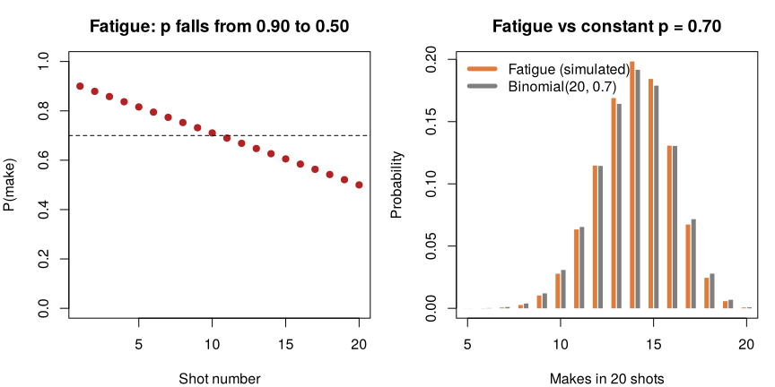

Figure 23: Left: the fatigue schedule for one 20-shot game. Right: total
makes in 20 shots, fatigue model vs Binomial(20, 0.7) with the same
mean.

</div>

In a single 20-shot game the fatigue model gives a variance of 3.91
makes², compared with 4.20 for Binomial(20, 0.7); the exact value is
3.91.

``` r
plot_sampling_grid(results$fatigue, common_x = FALSE)
```

<div id="fig-fatigue-hist">

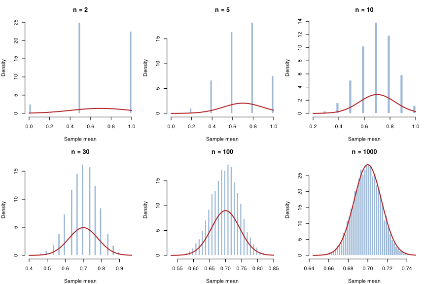

Figure 24: Sampling distributions of the shooting percentage with the
exact Poisson-binomial normal curve.

</div>

``` r
plot_qq_grid(results$fatigue)
```

<div id="fig-fatigue-qq">

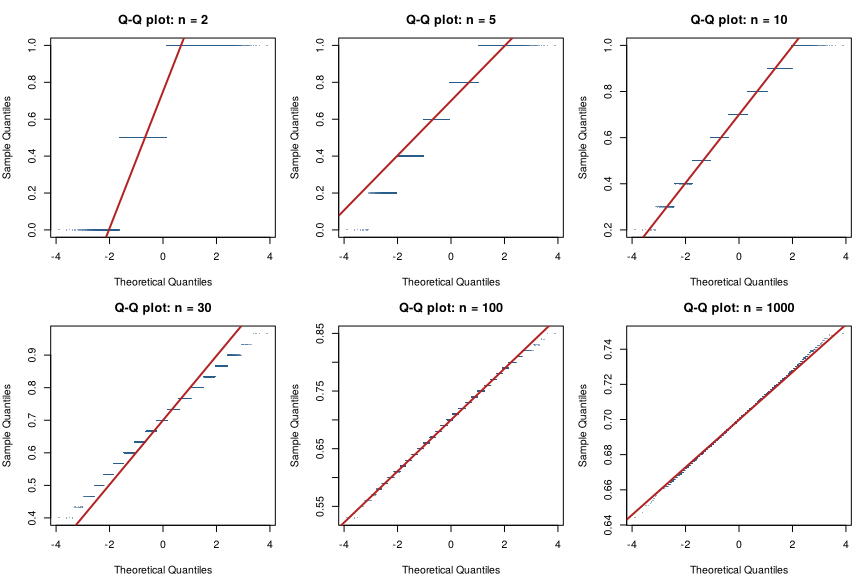

Figure 25: Q-Q plots for the fatigue model.

</div>

| n | Sim mean | Sim SD | Naive SE | SD / naive SE | Exact SE | SD / exact SE | Skew | Pred. skew | Tail rate | Normal |
|---:|---:|---:|---:|---:|---:|---:|---:|---:|---:|:---|
| 2 | 0.700 | 0.292 | 0.324 | 0.901 | 0.292 | 1.001 | -0.366 | -0.363 | 0.051 | No |
| 5 | 0.698 | 0.195 | 0.205 | 0.953 | 0.195 | 1.002 | -0.293 | -0.324 | 0.022 | No |
| 10 | 0.701 | 0.140 | 0.145 | 0.963 | 0.139 | 1.002 | -0.242 | -0.239 | 0.064 | No |
| 20 | 0.699 | 0.098 | 0.102 | 0.952 | 0.099 | 0.987 | -0.159 | -0.172 | 0.070 | No |
| 30 | 0.701 | 0.080 | 0.084 | 0.955 | 0.081 | 0.989 | -0.143 | -0.141 | 0.059 | Yes |
| 50 | 0.700 | 0.062 | 0.065 | 0.964 | 0.063 | 0.997 | -0.110 | -0.110 | 0.035 | No |
| 100 | 0.701 | 0.044 | 0.046 | 0.966 | 0.044 | 0.999 | -0.087 | -0.078 | 0.056 | Yes |
| 250 | 0.700 | 0.028 | 0.029 | 0.957 | 0.028 | 0.990 | -0.019 | -0.049 | 0.053 | Yes |
| 500 | 0.700 | 0.020 | 0.020 | 0.971 | 0.020 | 1.003 | -0.032 | -0.035 | 0.051 | Yes |
| 1000 | 0.700 | 0.014 | 0.014 | 0.967 | 0.014 | 1.000 | -0.003 | -0.025 | 0.049 | Yes |
| 2000 | 0.700 | 0.010 | 0.010 | 0.965 | 0.010 | 0.997 | -0.009 | -0.017 | 0.052 | Yes |

**Result.** The exact SE matches the simulation (ratio ≈ 1.00) while the
naive binomial SE is about 5% too large at every n. The skew is mild and
*negative*: most shots have p \> 0.5, so the distribution leans left. It
reaches the threshold quickly, consistent with the exact prediction of n
= 15. What delays the verdict is again **discreteness**: the shooting
percentage is a multiple of $1/n$, and the tail rate swings (7.0% at n =
20, 3.5% at n = 50). All checks pass from n = 100. Normality arrives,
but only with the correct variance formula.

## Age at death: a bimodal, real-world-shaped population

**Model** (from the course handout): a discrete distribution on ages
0–100 that mixes an exponentially decaying infant-mortality spike with a
bell centred at 65, normalized to sum to 1. It is synthetic and is not a
fitted life table.

**Prediction.** $\mu =$ 49.98, $\sigma =$ 27.63, skewness -0.86 (left
skew from the adult bulk), and excess kurtosis -0.79. Despite two modes,
the moments are modest, so theory predicts convergence by about n = 19.
The question is whether the bimodality causes problems the moments miss.

``` r
plot(age, 100 * age_prob, type = "l", lwd = 3, col = PAL$pop,
     xlab = "Age at death", ylab = "Percent of deaths",
     main = "Custom age-at-death distribution")
abline(h = seq(0, 4.5, 0.5), col = PAL$grid, lty = 2)
abline(v = age_mu, lty = 2, lwd = 2)
text(age_mu, 4.2, paste("mean =", fmt(age_mu, 1)), pos = 4)
```

<div id="fig-age-pop">

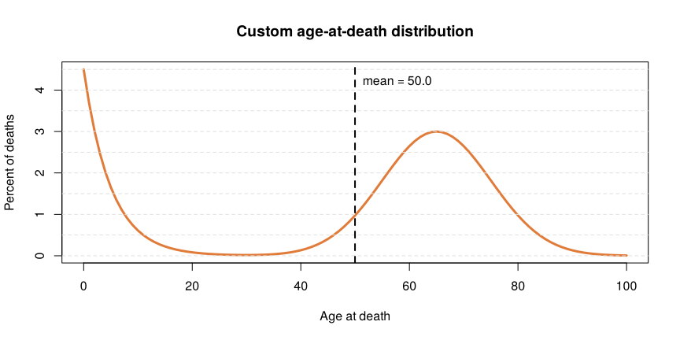

Figure 26: The custom age-at-death distribution: an early-life spike and
an adult peak near 65.

</div>

``` r
plot_sampling_grid(results$age, common_x = FALSE)
```

<div id="fig-age-hist">

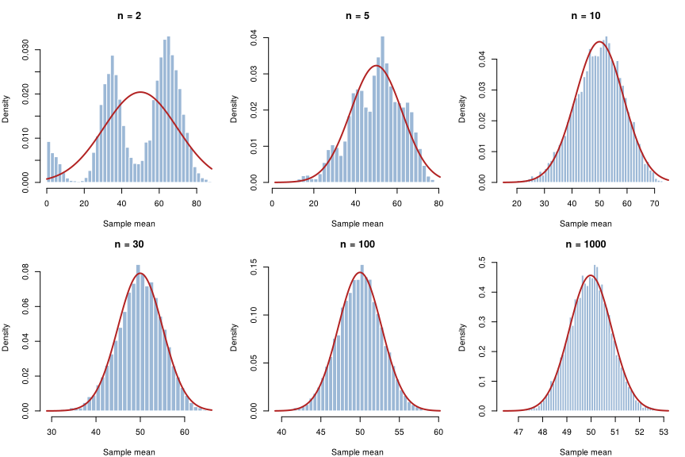

Figure 27: Sampling distributions of mean age at death.

</div>

``` r
plot_qq_grid(results$age)
```

<div id="fig-age-qq">

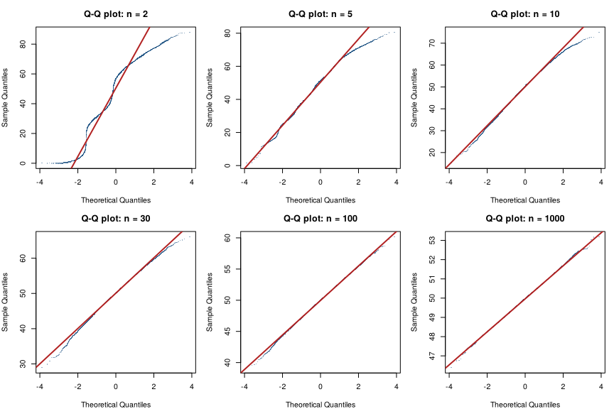

Figure 28: Q-Q plots for the age-at-death mean.

</div>

| n | Sim mean | Theory mean | Sim SD | Theory SE | SD/SE | Skew | Pred. skew | Ex. kurt | Pred. kurt | Tail rate | SW p | Normal |
|---:|---:|---:|---:|---:|---:|---:|---:|---:|---:|---:|---:|:---|
| 2 | 49.980 | 49.981 | 19.406 | 19.541 | 0.993 | -0.606 | -0.610 | -0.388 | -0.395 | 0.058 | 0.000 | No |
| 5 | 50.197 | 49.981 | 12.345 | 12.359 | 0.999 | -0.370 | -0.386 | -0.192 | -0.158 | 0.033 | 0.000 | No |
| 10 | 49.890 | 49.981 | 8.762 | 8.739 | 1.003 | -0.258 | -0.273 | -0.127 | -0.079 | 0.048 | 0.000 | No |
| 20 | 50.012 | 49.981 | 6.199 | 6.179 | 1.003 | -0.210 | -0.193 | -0.008 | -0.040 | 0.051 | 0.000 | No |
| 30 | 49.981 | 49.981 | 5.093 | 5.045 | 1.010 | -0.205 | -0.157 | 0.083 | -0.026 | 0.051 | 0.000 | No |
| 50 | 49.964 | 49.981 | 3.922 | 3.908 | 1.003 | -0.121 | -0.122 | -0.099 | -0.016 | 0.049 | 0.000 | Yes |
| 100 | 49.960 | 49.981 | 2.795 | 2.763 | 1.011 | -0.089 | -0.086 | 0.040 | -0.008 | 0.052 | 0.009 | Yes |
| 250 | 49.981 | 49.981 | 1.764 | 1.748 | 1.009 | -0.014 | -0.055 | 0.034 | -0.003 | 0.055 | 0.520 | Yes |
| 500 | 49.973 | 49.981 | 1.249 | 1.236 | 1.011 | -0.064 | -0.039 | -0.008 | -0.002 | 0.053 | 0.330 | Yes |
| 1000 | 49.971 | 49.981 | 0.863 | 0.874 | 0.988 | -0.012 | -0.027 | 0.029 | -0.001 | 0.048 | 0.230 | Yes |
| 2000 | 49.982 | 49.981 | 0.622 | 0.618 | 1.007 | -0.031 | -0.019 | -0.028 | 0.000 | 0.051 | 0.510 | Yes |

**Result.** Bimodality fades quickly: at n = 2 the histogram is still
lumpy (averaging an infant death with an adult death fills the middle),
but by n = 10 it is a single hump. The simulated skewness tracks
$\gamma_1/\sqrt n$, and every check passes from n = 50. The mean (49.98)
is a poor *description* of a typical death, since few people die near
50. Even so, the *sample mean* behaves well. The CLT is about the
statistic, not about whether the population is easy to describe.

# Cross-population comparison

``` r
plot_convergence_all(results)
```

<div id="fig-convergence-all">

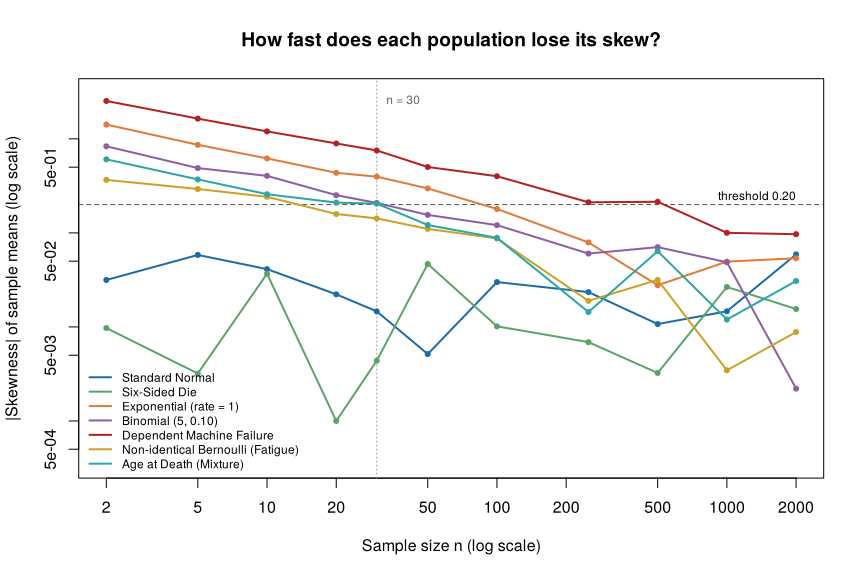

Figure 29: Skewness of the sample mean vs n for every population except
the Cauchy (log-log). For i.i.d. populations these are straight lines of
slope -1/2.

</div>

On a log-log scale the skewed i.i.d. populations fall along roughly
parallel lines of slope −1/2, as $\gamma_1/\sqrt n$ predicts, until they
reach the Monte Carlo noise floor (about 0.02–0.05 with 10,000
replications). The lines differ mainly in where they start. The normal
and die curves bounce around near zero because their true skewness is 0,
so only noise remains. The dependent process is the outlier, and stays
the most skewed throughout. At the n = 30 reference line, the
populations that pass comfortably are the ones that *started* symmetric
(normal, die). Age at death, with population skewness -0.86, sits right
at the threshold, and the strongly skewed populations are still well
above it.

## Prediction vs simulation

| Population | Predicted n (skew + kurtosis) | Observed n (all four checks) | Agrees? |
|:---|:---|:---|:---|
| Standard Normal | 1 | 2 | Yes |
| Six-Sided Die | 5 | 10 | Yes |
| Exponential (rate = 1) | 100 | 100 | Yes |
| Binomial (5, 0.10) | 36 | 50 | Yes |
| Cauchy (0, 1) | n/a | \> 2000 | \- |
| Dependent Machine Failure | n/a | 1000 | \- |
| Non-identical Bernoulli (Fatigue) | 15 | 100 | No |
| Age at Death (Mixture) | 19 | 50 | No |

The theoretical prediction is a good guide for the continuous i.i.d.
populations, within one grid step. Where the two diverge, the reason is
always the same: the prediction uses only skewness and kurtosis, while
the simulation also checks the **tail rate**, which discreteness can
upset. On a coarse grid, “observed n” also jumps to the next grid point
(for example, a prediction of 36 becomes an observed 50).

## Is Shapiro–Wilk useful here?

| Population | n=2 | n=5 | n=10 | n=20 | n=30 | n=50 | n=100 | n=250 | n=500 | n=1000 | n=2000 |
|:---|:---|:---|:---|:---|:---|:---|:---|:---|:---|:---|:---|
| Standard Normal | 7.6e-02 | 8.1e-03 | 1.4e-01 | 7.5e-01 | 8.8e-01 | 5.6e-01 | 8.5e-01 | 7.1e-01 | 8.4e-01 | 9.1e-01 | 2.7e-01 |
| Six-Sided Die | 1.6e-28 | 3.2e-15 | 4.3e-09 | 1.5e-05 | 9.0e-05 | 2.0e-03 | 1.6e-01 | 5.1e-02 | 2.9e-01 | 9.9e-02 | 9.7e-01 |
| Exponential (rate = 1) | 2.5e-49 | 8.4e-36 | 2.7e-27 | 5.2e-18 | 4.4e-19 | 9.0e-12 | 8.2e-05 | 4.4e-03 | 9.7e-01 | 6.1e-01 | 3.7e-01 |
| Binomial (5, 0.10) | 4.3e-57 | 6.5e-40 | 4.0e-30 | 9.0e-22 | 2.8e-17 | 1.0e-11 | 1.1e-09 | 6.0e-04 | 2.5e-02 | 2.9e-01 | 4.1e-01 |
| Cauchy (0, 1) | 1.0e-95 | 1.9e-92 | 1.1e-95 | 2.9e-93 | 9.3e-96 | 4.1e-91 | 8.8e-91 | 1.4e-94 | 2.9e-92 | 1.5e-93 | 1.9e-95 |
| Dependent Machine Failure | 2.4e-64 | 3.9e-54 | 1.3e-45 | 3.1e-36 | 8.7e-33 | 2.4e-23 | 3.5e-17 | 8.8e-08 | 2.6e-07 | 2.0e-02 | 4.4e-03 |
| Non-identical Bernoulli (Fatigue) | 2.7e-67 | 2.7e-49 | 1.3e-37 | 1.7e-28 | 2.3e-23 | 8.0e-18 | 1.0e-12 | 5.3e-06 | 9.4e-04 | 1.9e-02 | 2.8e-01 |
| Age at Death (Mixture) | 2.5e-43 | 7.1e-23 | 2.4e-10 | 3.4e-08 | 6.0e-07 | 2.4e-04 | 9.3e-03 | 5.2e-01 | 3.3e-01 | 2.3e-01 | 5.1e-01 |

At n = 30 Shapiro–Wilk rejects normality (p \< 0.05) for almost every
non-normal population, including the die and age at death, whose
histograms and Q–Q plots look essentially normal. With 5,000 values the
test has enough power to detect deviations far too small to matter for
inference. It answers “is this *exactly* normal?” (never, for a
non-normal parent), not “is normal *good enough*?” That is why I report
it but use effect-size checks for the verdict.

## Does the seed matter?

Conclusions should not depend on one lucky seed. I repeated the full
study for every population with 5 different seeds and recorded the
observed n each time.

``` r
robust <- sapply(names(populations), function(id) {
  sapply(seq_along(ROBUSTNESS_SEEDS), function(s) {
    # same per-population offset as the main run, so the first column reproduces it
    set.seed(ROBUSTNESS_SEEDS[s] + match(id, names(populations)))
    means <- lapply(N_GRID, function(n) populations[[id]]$means(n, REPS))
    first_stable_n(diagnose_all(means, populations[[id]]))
  })
})
robust_tbl <- data.frame(
  Population = vapply(populations, `[[`, "", "label"),
  t(apply(robust, 2, show_n)),
  check.names = FALSE
)
names(robust_tbl)[-1] <- paste("Seed", ROBUSTNESS_SEEDS)
kbl(robust_tbl)
```

| Population | Seed 6877 | Seed 7877 | Seed 8877 | Seed 9877 | Seed 10877 |
|:---|:---|:---|:---|:---|:---|
| Standard Normal | 2 | 2 | 2 | 2 | 2 |
| Six-Sided Die | 10 | 10 | 10 | 10 | 10 |
| Exponential (rate = 1) | 100 | 100 | 250 | 250 | 100 |
| Binomial (5, 0.10) | 50 | 50 | 50 | 50 | 50 |
| Cauchy (0, 1) | \> 2000 | \> 2000 | \> 2000 | \> 2000 | \> 2000 |
| Dependent Machine Failure | 1000 | 500 | 2000 | 1000 | 500 |
| Non-identical Bernoulli (Fatigue) | 100 | 100 | 100 | 100 | 100 |
| Age at Death (Mixture) | 50 | 20 | 30 | 30 | 20 |

The ordering of the populations is stable across seeds: normal, die and
age at death converge early; binomial and exponential need tens to
hundreds; the dependent process needs the most; the Cauchy never
converges. Where a population sits on the boundary of my thresholds (the
exponential near n = 100, or the lattice-valued populations whose tail
rate oscillates), the exact grid point shifts by one or two steps
between seeds. That variation is itself a finding: “the n” is a range,
not a number.

# Conclusions

**Is the number 30?** Only for some populations, and the evidence says
which:

- **Symmetric, i.i.d., finite variance** (normal, die): n = 30 is more
  than enough. The normal is exact at every n; the die passes from about
  n = 10.
- **Moderately skewed** (age at death, $\gamma_1 =$ -0.86): n = 30 is
  roughly the boundary. Theory predicts 19, and the observed n ranged
  over 20 to 50 across seeds, because the skewness of the mean at n =
  20–30 sits right at my 0.20 line. Bimodality by itself did not slow
  convergence.
- **Strongly skewed** (exponential, $\gamma_1 = 2$): n = 30 leaves
  visible skew (0.40). The rule $n \gtrsim (\gamma_1/0.2)^2$ predicted
  100, and the simulation confirmed it (observed 100 to 250 across
  seeds). **Skewness is the single best predictor of the required n.**
- **Discrete and skewed** (binomial n = 5, p = 0.1): predicted 36,
  observed 50, and lattice effects make normal-based tail probabilities
  unreliable at small n even when the moments look fine.
- **Infinite variance** (Cauchy): no n works. The mean of 2,000 draws is
  as variable as one draw. Use the median.
- **Dependent data**: convergence is much slower (observed 500 to 2000
  across seeds). More importantly, the $\sigma/\sqrt n$ formula is wrong
  (here by about 16%) regardless of n.
- **Non-identical data**: the CLT still holds (Lindeberg–Feller), but
  the variance must come from the actual $p_t$, not from the average p.

Across every population, the CLT got the **center** right immediately
and the **spread** right whenever the correct SE formula was used. It is
the **shape** that needs a large n, and how large depends on the
skewness of what you average.

**Limitations and what would change my mind.**

- The criterion is mine. A stricter skewness threshold (say 0.1) would
  roughly quadruple every predicted n. The *ranking* of populations
  would not change.
- The n grid is coarse, so “observed n” is the first grid point that
  passes, not an exact boundary.
- 10,000 replications cannot resolve skewness differences below about
  0.05. Populations right at a threshold can flip between seeds
  (<a href="#sec-robust" class="quarto-xref">Section 5.3</a>).
- The dependent process’s “true” moments come from a long simulation,
  not a closed form. Its SE formula truncates autocorrelations at lag
  30, where they are below 0.01.
- Each extra-credit model is a stylized version from the course handout,
  not a fitted real-world model.

# Appendix: code

All simulation code is reusable and lives in `R/`. It is reproduced here
so this report is self-contained.

<div class="panel-tabset">

## config.R

``` r
# =============================================================================
# config.R
# Every tunable setting for the project lives here, so a reader can reproduce
# (or deliberately change) the whole study by editing one file.
# =============================================================================

# Reproducibility ------------------------------------------------------------
# The course requires the seed to be the last four digits of the student ID.
STUDENT_ID_LAST4 <- 6877L   # last four digits of student ID
SEED <- STUDENT_ID_LAST4

# Monte Carlo design ---------------------------------------------------------
# REPS  = number of simulated samples (how many sample means we compute).
# N_GRID = sample sizes n (how many observations go into ONE sample mean).
# These are different quantities: 10,000 reps of n = 30 means 10,000 sample
# means, each built from 30 observations. The sample size is still 30.
REPS   <- 10000L
N_GRID <- c(2, 5, 10, 20, 30, 50, 100, 250, 500, 1000, 2000)

# Sample sizes shown in the histogram / Q-Q panels (a subset of N_GRID).
N_SHOW <- c(2, 5, 10, 30, 100, 1000)

# "Approximately normal" criterion ---------------------------------------------
# A sampling distribution counts as approximately normal at a given n only if
# ALL four checks pass. Thresholds are chosen to be several Monte Carlo
# standard errors wide, so that a pass/fail is not caused by simulation noise
# (with 10,000 reps: SE(skewness) ~ 0.025, SE(excess kurtosis) ~ 0.05,
# SE(tail rate) ~ 0.002, relative SE(sd) ~ 0.7%).
CRITERIA <- list(
  skew     = 0.20,          # |skewness| <= 0.20
  exkurt   = 0.30,          # |excess kurtosis| <= 0.30
  se_ratio = c(0.97, 1.03), # simulated SD / correct theoretical SE
  tail     = c(0.04, 0.06)  # share of means beyond mu +/- 1.96 SE (normal: 0.05)
)

# Seeds used for the robustness check (does the conclusion depend on the seed?)
ROBUSTNESS_SEEDS <- SEED + c(0, 1000, 2000, 3000, 4000)
```

## populations.R

``` r
# =============================================================================
# populations.R
# Each population is a list with the same fields, so one simulation engine
# can treat all of them alike:
#
#   id, label        short key and display name
#   kind             "continuous" or "discrete"
#   assumptions      which CLT conditions hold (independent / identical / finite var)
#   draw(m)          m individual observations (used to plot the population)
#   means(n, reps)   `reps` sample means, each from a sample of size n
#   mu               mean of the sample mean (the CLT centre)
#   sigma            population SD (NA if it does not exist)
#   se(n)            the CORRECT theoretical SD of the sample mean
#   se_naive(n)      the textbook sigma / sqrt(n) (differs from se() only when
#                    the i.i.d. assumption fails)
#   skew, exkurt     population skewness and excess kurtosis (NA if undefined)
#   skew_n(n), exkurt_n(n)  predicted skewness / kurtosis of the sample mean
# =============================================================================

# Sample means for i.i.d. data ------------------------------------------------
# Fill a (reps x n) matrix where each ROW is one sample, then take rowMeans.
# Large n is processed in blocks of rows to keep memory use modest.
iid_means <- function(draw, n, reps, max_cells = 2e6) {
  block <- max(1L, floor(max_cells / n))
  starts <- seq(1L, reps, by = block)
  unlist(lapply(starts, function(s) {
    r <- min(block, reps - s + 1L)
    rowMeans(matrix(draw(n * r), nrow = r, ncol = n))
  }))
}

# Helper: build an i.i.d. population from a random-number generator ----------
# For i.i.d. data with finite moments, the sample mean of n observations has
#   SE = sigma / sqrt(n),  skewness = skew / sqrt(n),  excess kurtosis = exkurt / n.
# These formulas give a PREDICTION of how quickly each population converges.
make_iid_population <- function(id, label, kind, draw, mu, sigma, skew, exkurt,
                                notes = "") {
  finite_var <- is.finite(sigma)
  list(
    id = id, label = label, kind = kind, notes = notes,
    assumptions = c(independent = TRUE, identical = TRUE, finite_variance = finite_var),
    draw  = draw,
    means = function(n, reps) iid_means(draw, n, reps),
    mu = mu, sigma = sigma, skew = skew, exkurt = exkurt,
    se       = function(n) sigma / sqrt(n),
    se_naive = function(n) sigma / sqrt(n),
    skew_n   = function(n) skew / sqrt(n),
    exkurt_n = function(n) exkurt / n
  )
}

# 1. Standard normal ---------------------------------------------------------
pop_normal <- make_iid_population(
  id = "normal", label = "Standard Normal", kind = "continuous",
  draw = function(m) rnorm(m, 0, 1),
  mu = 0, sigma = 1, skew = 0, exkurt = 0,
  notes = "Control case: the mean of normals is exactly normal for every n."
)

# 2. Fair six-sided die (discrete uniform on 1..6) -------------------------
die_values <- 1:6
pop_die <- make_iid_population(
  id = "die", label = "Six-Sided Die", kind = "discrete",
  draw = function(m) sample.int(6L, m, replace = TRUE),
  mu = 3.5,
  sigma = sqrt(35 / 12),                      # (k^2 - 1) / 12 with k = 6
  skew = 0,
  exkurt = -6 * (6^2 + 1) / (5 * (6^2 - 1)),  # discrete uniform: about -1.269
  notes = "Symmetric, bounded, flat (light tails)."
)

# 3. Exponential(rate = 1) -------------------------------------------------
pop_exp <- make_iid_population(
  id = "exponential", label = "Exponential (rate = 1)", kind = "continuous",
  draw = function(m) rexp(m, rate = 1),
  mu = 1, sigma = 1, skew = 2, exkurt = 6,
  notes = "Strong right skew; the classic slow-converging example."
)

# 4. Binomial(size = 5, p = 0.10) ------------------------------------------
b_size <- 5; b_p <- 0.10
b_var  <- b_size * b_p * (1 - b_p)
pop_binom <- make_iid_population(
  id = "binomial", label = "Binomial (5, 0.10)", kind = "discrete",
  draw = function(m) rbinom(m, size = b_size, prob = b_p),
  mu = b_size * b_p,
  sigma = sqrt(b_var),
  skew = (1 - 2 * b_p) / sqrt(b_var),
  exkurt = (1 - 6 * b_p * (1 - b_p)) / b_var,
  notes = "Highly discrete: 59% of draws are 0; strong right skew."
)

# 5. Cauchy(0, 1) -----------------------------------------------------------
# Mean and variance do not exist, so every moment-based formula is undefined.
pop_cauchy <- make_iid_population(
  id = "cauchy", label = "Cauchy (0, 1)", kind = "continuous",
  draw = function(m) rcauchy(m, location = 0, scale = 1),
  mu = 0,           # location / median, NOT a mean
  sigma = NA_real_, skew = NA_real_, exkurt = NA_real_,
  notes = "No finite mean or variance: the CLT's assumptions fail."
)

# =============================================================================
# Extra credit populations
# =============================================================================

# 6. Dependent machine-failure process --------------------------------------
#   lambda_t = lambda0 * exp(beta * (X_{t-1} - mu_ref)),   X_t | X_{t-1} ~ Exp(lambda_t)
# Simulation is vectorised ACROSS replications: `x` holds the current
# operating time for all `reps` independent machines, and we step every
# machine forward one failure at a time. A burn-in lets each machine forget
# its starting value so that samples come from the long-run (stationary)
# behaviour of the process rather than from its start-up period.
dep_params <- list(lambda0 = 1, beta = 1.25, mu_ref = 1, burn_in = 50)

dependent_step <- function(x, p = dep_params) {
  rexp(length(x), rate = p$lambda0 * exp(p$beta * (x - p$mu_ref)))
}

dependent_means <- function(n, reps, p = dep_params) {
  x <- rexp(reps, rate = p$lambda0)                # first operating time
  for (b in seq_len(p$burn_in)) x <- dependent_step(x, p)
  total <- numeric(reps)
  for (t in seq_len(n)) {
    x <- dependent_step(x, p)
    total <- total + x
  }
  total / n
}

dependent_chain <- function(len, p = dep_params) {
  x <- numeric(len + p$burn_in)
  x[1] <- rexp(1, p$lambda0)
  for (t in 2:length(x)) x[t] <- dependent_step(x[t - 1], p)
  x[-seq_len(p$burn_in)]
}

# The stationary moments of this process have no simple closed form, so we
# estimate them ONCE from a very long chain. Because the observations are
# correlated, Var(mean) is NOT sigma^2 / n. For a stationary series,
#   n * Var(X-bar) -> sigma^2 * (1 + 2 * sum_k rho_k)  (the long-run variance).
estimate_dependent_moments <- function(len = 1e6, max_lag = 30, seed = 1) {
  set.seed(seed)
  chain <- dependent_chain(len)
  rho <- acf(chain, lag.max = max_lag, plot = FALSE)$acf[-1]
  s   <- sd(chain)
  z   <- (chain - mean(chain)) / s
  list(
    chain_mean = mean(chain), chain_sd = s,
    skew = mean(z^3), exkurt = mean(z^4) - 3,
    rho = rho,
    lrv_factor = 1 + 2 * sum(rho),          # long-run variance / sigma^2
    chain_head = chain[1:200]
  )
}

# Exact variance of the mean of n consecutive values of a stationary series:
#   Var(X-bar) = (sigma^2 / n) * [1 + 2 * sum_{k=1}^{n-1} (1 - k/n) * rho_k]
# Autocorrelations beyond the estimated lags are treated as zero (they decay
# geometrically and are below 0.01 by lag ~20).
dependent_se <- function(n, mom) {
  k <- seq_len(min(n - 1, length(mom$rho)))
  factor <- 1 + 2 * sum((1 - k / n) * mom$rho[k])
  mom$chain_sd * sqrt(factor / n)
}

make_dependent_population <- function(mom) {
  list(
    id = "dependent", label = "Dependent Machine Failure", kind = "continuous",
    notes = "Exponential conditional on the previous failure; negative dependence.",
    assumptions = c(independent = FALSE, identical = TRUE, finite_variance = TRUE),
    draw  = function(m) dependent_chain(m),
    means = dependent_means,
    mu = mom$chain_mean, sigma = mom$chain_sd,
    skew = mom$skew, exkurt = mom$exkurt,
    se       = function(n) dependent_se(n, mom),    # accounts for autocorrelation
    se_naive = function(n) mom$chain_sd / sqrt(n),  # pretends data are i.i.d.
    skew_n   = function(n) NA_real_,
    exkurt_n = function(n) NA_real_,
    moments = mom
  )
}

# 7. Non-identical Bernoulli (basketball fatigue) ---------------------------
# A sample of size n is n shots whose make probability falls linearly from
# 0.90 (first shot) to 0.50 (last shot). Shots are independent but NOT
# identically distributed. Average p is exactly 0.70 for every n.
fatigue_p <- function(n, p_start = 0.90, p_end = 0.50) {
  seq(p_start, p_end, length.out = n)
}

fatigue_means <- function(n, reps) {
  p <- fatigue_p(n)
  # matrix fills column-wise, so column j holds shot j for every replication
  made <- matrix(rbinom(n * reps, size = 1, prob = rep(p, each = reps)),
                 nrow = reps, ncol = n)
  rowMeans(made)
}

# Exact moments of a Poisson-binomial proportion (sum of independent Bernoullis)
fatigue_moments <- function(n) {
  p <- fatigue_p(n); v <- p * (1 - p)
  list(
    mean = mean(p),
    se = sqrt(sum(v)) / n,
    skew = sum(v * (1 - 2 * p)) / sum(v)^1.5,
    exkurt = sum(v * (1 - 6 * v)) / sum(v)^2
  )
}

pop_fatigue <- list(
  id = "fatigue", label = "Non-identical Bernoulli (Fatigue)", kind = "discrete",
  notes = "Independent shots, but p falls from 0.90 to 0.50.",
  assumptions = c(independent = TRUE, identical = FALSE, finite_variance = TRUE),
  draw  = function(m) rbinom(m, 1, fatigue_p(m)),
  means = fatigue_means,
  mu = 0.70, sigma = sqrt(0.7 * 0.3),
  skew = NA_real_, exkurt = NA_real_,  # no single population: p changes per shot
  se       = function(n) fatigue_moments(n)$se,
  se_naive = function(n) sqrt(0.7 * 0.3 / n),       # pretends every p = 0.70
  skew_n   = function(n) fatigue_moments(n)$skew,
  exkurt_n = function(n) fatigue_moments(n)$exkurt
)

# 8. Custom age-at-death distribution (two-component mixture) ---------------
age <- 0:100
age_weight <- 0.045 * exp(-age / 5) +                 # early-death component
              0.030 * exp(-0.5 * ((age - 65) / 10)^2)  # adult-death component
age_prob <- age_weight / sum(age_weight)

age_mu     <- sum(age * age_prob)
age_sigma  <- sqrt(sum((age - age_mu)^2 * age_prob))
age_skew   <- sum(((age - age_mu) / age_sigma)^3 * age_prob)
age_exkurt <- sum(((age - age_mu) / age_sigma)^4 * age_prob) - 3

rdeath <- function(m) sample(age, size = m, replace = TRUE, prob = age_prob)

pop_age <- make_iid_population(
  id = "age", label = "Age at Death (Mixture)", kind = "discrete",
  draw = rdeath,
  mu = age_mu, sigma = age_sigma, skew = age_skew, exkurt = age_exkurt,
  notes = "Bimodal: infant-mortality spike plus a bell centred at 65."
)
```

## simulate.R

``` r
# =============================================================================
# simulate.R
# The Monte Carlo engine and the normality diagnostics.
# =============================================================================

# Moment-based shape statistics (population formulas, as in the class notes) --
skewness <- function(x) {
  d <- x - mean(x)
  mean(d^3) / mean(d^2)^(3 / 2)
}

excess_kurtosis <- function(x) {
  d <- x - mean(x)
  mean(d^4) / mean(d^2)^2 - 3
}

# Shapiro-Wilk accepts at most 5,000 values, so test a random subsample.
shapiro_subsample <- function(x, size = 5000) {
  x <- sample(x, min(size, length(x)))
  if (length(unique(x)) < 3) return(c(W = NA_real_, p = NA_real_))
  r <- shapiro.test(x)
  c(W = unname(r$statistic), p = r$p.value)
}

# Simulate the sampling distribution of the mean for every n -------------------
# Returns a named list: one vector of `reps` sample means per sample size.
simulate_means <- function(pop, n_grid = N_GRID, reps = REPS, seed = SEED) {
  set.seed(seed)
  out <- lapply(n_grid, function(n) pop$means(n, reps))
  names(out) <- paste0("n", n_grid)
  out
}

# Diagnose one vector of sample means -----------------------------------------
diagnose_means <- function(means, pop, n, criteria = CRITERIA) {
  se_true  <- pop$se(n)
  se_naive <- pop$se_naive(n)
  z <- (means - pop$mu) / se_true
  sw <- shapiro_subsample(means)

  sk <- skewness(means)
  ku <- excess_kurtosis(means)
  ratio <- sd(means) / se_true
  tail  <- mean(abs(z) > 1.96)

  checks <- c(
    skew     = abs(sk) <= criteria$skew,
    exkurt   = abs(ku) <= criteria$exkurt,
    se_ratio = isTRUE(ratio >= criteria$se_ratio[1] & ratio <= criteria$se_ratio[2]),
    tail     = isTRUE(tail >= criteria$tail[1] & tail <= criteria$tail[2])
  )
  checks[is.na(checks)] <- FALSE

  data.frame(
    population     = pop$label,
    n              = n,
    sim_mean       = mean(means),
    theo_mean      = pop$mu,
    sim_sd         = sd(means),
    theo_se        = se_true,
    naive_se       = se_naive,
    se_ratio       = ratio,
    naive_ratio    = sd(means) / se_naive,
    skewness       = sk,
    pred_skewness  = pop$skew_n(n),
    exkurt         = ku,
    pred_exkurt    = pop$exkurt_n(n),
    tail_rate      = tail,
    sw_W           = sw[["W"]],
    sw_p           = sw[["p"]],
    iqr            = IQR(means),
    pass_skew      = checks[["skew"]],
    pass_exkurt    = checks[["exkurt"]],
    pass_se        = checks[["se_ratio"]],
    pass_tail      = checks[["tail"]],
    approx_normal  = all(checks),
    row.names = NULL
  )
}

diagnose_all <- function(means_list, pop, n_grid = N_GRID) {
  do.call(rbind, Map(function(m, n) diagnose_means(m, pop, n), means_list, n_grid))
}

# Smallest n from which the criterion passes and KEEPS passing ----------------
# (a single lucky pass followed by failures does not count).
first_stable_n <- function(diag) {
  ok <- diag$approx_normal
  if (!ok[length(ok)]) return(NA_real_)
  last_fail <- max(c(0, which(!ok)))
  diag$n[last_fail + 1]
}

# Theory-based prediction of the n needed for the skewness / kurtosis checks --
# For i.i.d. data: skew(X-bar) = skew / sqrt(n), exkurt(X-bar) = exkurt / n.
# For the fatigue model the exact Poisson-binomial formulas are used instead.
# Returns NA when no theory is available (Cauchy, dependent process).
predict_n <- function(pop, criteria = CRITERIA, n_max = 5000) {
  ns <- 1:n_max
  sk <- vapply(ns, pop$skew_n, numeric(1))
  ku <- vapply(ns, pop$exkurt_n, numeric(1))
  if (all(is.na(sk))) return(NA_real_)
  ok <- abs(sk) <= criteria$skew & abs(ku) <= criteria$exkurt
  ok[is.na(ok)] <- FALSE
  if (!ok[n_max]) return(NA_real_)
  ns[max(c(0, which(!ok))) + 1]
}

# Run everything for one population ------------------------------------------
run_population <- function(pop, seed_offset = 0, n_grid = N_GRID, reps = REPS) {
  means <- simulate_means(pop, n_grid, reps, seed = SEED + seed_offset)
  diag  <- diagnose_all(means, pop, n_grid)
  list(pop = pop, means = means, diag = diag,
       stable_n = first_stable_n(diag), predicted_n = predict_n(pop))
}
```

## plots.R

``` r
# =============================================================================
# plots.R
# Base-R plotting helpers, so every population gets identical, comparable
# figures.
# =============================================================================

PAL <- list(
  pop    = "#E07B39",  # population (individual values)
  bars   = "#9CB8D6",  # sampling-distribution histograms
  normal = "#B22222",  # CLT-predicted normal curve
  pass   = "#2E7D5B",
  fail   = "#B22222",
  grid   = "gray88"
)

# Population: what do the individual observations look like? ---------------
plot_population <- function(pop, m = 10000, xlim = NULL, main = NULL, ...) {
  x <- pop$draw(m)
  main <- if (is.null(main)) paste0(pop$label, ": ", format(m, big.mark = ","),
                                    " individual values") else main
  if (pop$kind == "discrete") {
    tab <- table(factor(x, levels = sort(unique(x))))
    plot(as.numeric(names(tab)), as.numeric(tab) / m, type = "h", lwd = 6,
         lend = 1, col = PAL$pop, xlab = "Individual value",
         ylab = "Proportion", main = main, xlim = xlim, ...)
  } else {
    shown <- if (is.null(xlim)) x else x[x >= xlim[1] & x <= xlim[2]]
    if (is.null(xlim)) xlim <- range(shown)
    hist(shown, breaks = 60, probability = TRUE, col = PAL$pop, border = "white",
         xlab = "Individual value", main = main, xlim = xlim, ...)
  }
  abline(v = pop$mu, lty = 2, lwd = 2)
  invisible(x)
}

# Sampling distributions with the CLT normal curve, one panel per n -------------
plot_sampling_grid <- function(res, n_show = N_SHOW, common_x = TRUE,
                               xlim = NULL, ncol = 3) {
  pop <- res$pop
  nr <- ceiling(length(n_show) / ncol)
  old <- par(mfrow = c(nr, ncol), mar = c(4, 4, 3, 1))
  on.exit(par(old))
  if (is.null(xlim) && common_x) {
    xlim <- range(unlist(res$means[paste0("n", n_show)]), na.rm = TRUE)
  }
  for (n in n_show) {
    m <- res$means[[paste0("n", n)]]
    xl <- if (common_x || !is.null(xlim)) xlim else range(m)
    shown <- m[m >= xl[1] & m <= xl[2]]
    hist(shown, breaks = 50, probability = TRUE, col = PAL$bars,
         border = "white", xlim = xl, main = paste("n =", n),
         xlab = "Sample mean")
    se <- pop$se(n)
    if (is.finite(se)) {
      curve(dnorm(x, mean = pop$mu, sd = se), add = TRUE,
            col = PAL$normal, lwd = 2, n = 400)
    }
  }
}

# Normal Q-Q plots, one panel per n ------------------------------------------
plot_qq_grid <- function(res, n_show = N_SHOW, ncol = 3) {
  nr <- ceiling(length(n_show) / ncol)
  old <- par(mfrow = c(nr, ncol), mar = c(4, 4, 3, 1))
  on.exit(par(old))
  for (n in n_show) {
    m <- res$means[[paste0("n", n)]]
    qqnorm(m, main = paste("Q-Q plot: n =", n), pch = 16, cex = 0.3,
           col = adjustcolor("#2B5C8A", 0.5))
    qqline(m, col = PAL$normal, lwd = 2)
  }
}

# Skewness and excess kurtosis against n, with theory and thresholds --------
plot_shape_trend <- function(res, criteria = CRITERIA) {
  d <- res$diag; pop <- res$pop
  old <- par(mfrow = c(1, 2), mar = c(4, 4, 3, 1))
  on.exit(par(old))
  ns_fine <- exp(seq(log(min(d$n)), log(max(d$n)), length.out = 200))
  for (what in c("skewness", "exkurt")) {
    y  <- d[[what]]
    th <- if (what == "skewness") criteria$skew else criteria$exkurt
    pred <- vapply(ns_fine, if (what == "skewness") pop$skew_n else pop$exkurt_n,
                   numeric(1))
    yl <- range(c(y, pred, th, -th), na.rm = TRUE)
    plot(d$n, y, log = "x", pch = 19, ylim = yl,
         col = ifelse(abs(y) <= th, PAL$pass, PAL$fail),
         xlab = "Sample size n (log scale)",
         ylab = if (what == "skewness") "Skewness of sample means" else "Excess kurtosis of sample means",
         main = if (what == "skewness") "Skewness vs n" else "Excess kurtosis vs n")
    rect(1e-3, -th, 1e6, th, col = adjustcolor(PAL$pass, 0.08), border = NA)
    abline(h = 0, col = "gray50")
    abline(h = c(-th, th), lty = 3, col = PAL$pass)
    if (!all(is.na(pred))) lines(ns_fine, pred, lwd = 2, col = "gray30", lty = 2)
    points(d$n, y, pch = 19, col = ifelse(abs(y) <= th, PAL$pass, PAL$fail))
    legend("topright", bty = "n", cex = 0.8,
           legend = c("Simulated", if (!all(is.na(pred))) "Theory", "Threshold band"),
           pch = c(19, if (!all(is.na(pred))) NA, 15),
           lty = c(NA, if (!all(is.na(pred))) 2, NA),
           col = c("gray20", if (!all(is.na(pred))) "gray30", adjustcolor(PAL$pass, 0.3)))
  }
}

# Simulated SD vs theoretical SE ------------------------------------------------
plot_se_check <- function(res, show_naive = FALSE) {
  d <- res$diag
  yl <- range(c(d$sim_sd, d$theo_se, if (show_naive) d$naive_se), na.rm = TRUE)
  plot(d$n, d$sim_sd, log = "xy", pch = 19, ylim = yl,
       xlab = "Sample size n (log scale)", ylab = "SD of sample means (log scale)",
       main = paste0(res$pop$label, ": spread shrinks like 1/sqrt(n)"))
  lines(d$n, d$theo_se, col = PAL$normal, lwd = 2)
  leg <- c("Simulated SD", "Correct theoretical SE")
  cols <- c("black", PAL$normal); lt <- c(NA, 1); pc <- c(19, NA)
  if (show_naive) {
    lines(d$n, d$naive_se, col = "gray40", lwd = 2, lty = 2)
    leg <- c(leg, "Naive i.i.d. sigma/sqrt(n)")
    cols <- c(cols, "gray40"); lt <- c(lt, 2); pc <- c(pc, NA)
  }
  legend("topright", legend = leg, col = cols, lty = lt, pch = pc, bty = "n")
}

# All populations together: |skewness| of the sample mean vs n ----------------
plot_convergence_all <- function(results, criteria = CRITERIA) {
  cols <- c("#1B6CA8", "#5AA469", "#E07B39", "#8E5EA2", "#B22222",
            "#C9A227", "#2CA6A4", "#6B4F3A")
  finite <- Filter(function(r) r$pop$id != "cauchy", results)
  ys <- unlist(lapply(finite, function(r) abs(r$diag$skewness)))
  plot(NULL, log = "xy", xlim = range(N_GRID), ylim = c(min(ys[ys > 0]) * 0.8, max(ys) * 1.2),
       xlab = "Sample size n (log scale)", ylab = "|Skewness| of sample means (log scale)",
       main = "How fast does each population lose its skew?")
  abline(h = criteria$skew, lty = 2, col = "gray30")
  text(max(N_GRID), criteria$skew, sprintf("threshold %.2f", criteria$skew),
       adj = c(1, -0.5), cex = 0.75)
  abline(v = 30, lty = 3, col = "gray60")
  text(30, max(ys), "n = 30", pos = 4, cex = 0.75, col = "gray40")
  for (i in seq_along(finite)) {
    d <- finite[[i]]$diag
    y <- pmax(abs(d$skewness), 1e-3)
    lines(d$n, y, col = cols[i], lwd = 2)
    points(d$n, y, col = cols[i], pch = 19, cex = 0.7)
  }
  legend("bottomleft", legend = vapply(finite, function(r) r$pop$label, ""),
         col = cols[seq_along(finite)], lwd = 2, bty = "n", cex = 0.75)
}
```

</div>

## Session information

``` r
sessionInfo()
```

    R version 4.3.3 (2024-02-29)
    Platform: x86_64-pc-linux-gnu (64-bit)
    Running under: Ubuntu 24.04.5 LTS

    Matrix products: default
    BLAS:   /usr/lib/x86_64-linux-gnu/blas/libblas.so.3.12.0 
    LAPACK: /usr/lib/x86_64-linux-gnu/lapack/liblapack.so.3.12.0

    locale:
    [1] C

    time zone: America/Los_Angeles
    tzcode source: system (glibc)

    attached base packages:
    [1] stats     graphics  grDevices utils     datasets  methods   base     

    loaded via a namespace (and not attached):
     [1] compiler_4.3.3  fastmap_1.1.1   cli_3.6.2       tools_4.3.3    
     [5] htmltools_0.5.7 yaml_2.3.8      rmarkdown_2.25  knitr_1.45     
     [9] jsonlite_1.8.8  xfun_0.41       digest_0.6.34   rlang_1.1.3    
    [13] evaluate_0.23  
